# moectf2026 W

## 目录

- [misc](#misc)
  
  - [Pixel_Art WP](#pixel_art-wp)
  - [Tomato WP](#tomato-wp)
  - [Wedge in the Wire WP](#wedge-in-the-wire-wp)
  - [基米文件 WP](#基米文件-wp)
  - [魔理沙偷走了重要的东西](#魔理沙偷走了重要的东西)
  - [西复问答 WP](#西复问答wp)
- [dev](#dev)
  
  - [当 Nginx 不在家WP](#当-nginx-不在家wp)
  - [网络日志取证大师](#网络日志取证大师)
- [Web](#web)
  
  - [熊出没WP](#熊出没wp)
  - [七狗免费小说WP](#七狗免费小说wp)
  
- [Reverse](#reverse)
  
  - [Assembly WP](#assembly-wp)
  
  - [bbxor WP](#bbxor-wp)
  
    
  
    

- [Crypto](#crypto)
  
  - [justXOR WP](#justxor-wp)
  - [wsl_Sign1n WP](#wsl_sign1n-wp)

---

## misc

### Pixel_Art WP

> cloverdayssss对xing进行了数字轰炸
>
> xing："看不懂，记一下……"
>
> 第1天收到了："25 31 32 36 37 40 43 44 45 46 47 55 56 57 58 59 61 69 98 106 120 129 138 139 140 143 144"
>
> 第2天收到了："25 30 35 43 59 61 68 69 97 98 106 120 128 129 137 141 145"
>
> 第3天收到了："0 1 3 7 8 9 13 14 15 19 20 21 24 25 26 29 30 31 35 39 40 43 44 45 46 58 61 62 63 64 69 74 75 76 77 86 87 88 89 91 93 94 98 103 104 105 106 115 116 117 120 121 122 123 127 129 132 134 135 141 145"
>
> 第4天收到了："0 2 4 6 10 12 16 18 25 30 35 40 47 57 61 65 69 73 85 89 91 92 98 102 106 114 120 124 126 129 132 133 140 145"
>
> 第5天收到了："0 2 4 6 10 12 13 14 15 16 18 25 30 34 35 40 47 57 61 65 69 74 75 76 85 89 91 98 102 106 114 120 124 126 127 128 129 130 132 139 145 146"
>
> 第6天收到了："0 2 4 6 10 12 18 25 30 35 40 43 47 56 61 65 69 77 86 87 88 89 91 98 102 106 114 120 124 129 132 145"
>
> 第7天收到了："0 2 4 7 8 9 13 14 15 19 20 21 26 27 30 35 39 40 41 44 45 46 56 61 65 68 69 70 73 74 75 76 89 91 97 98 99 103 104 105 106 115 116 117 120 124 129 132 139 145"
>
> 第8天收到了："35 85 89 145"
>
> 第9天收到了："36 37 49 50 51 52 53 79 80 81 82 83 86 87 88 108 109 110 111 112 143 144"
>
> xing：什么叫这是像素画啊？这最多也只能是个点啊……什么坐标轴？
>
> 温馨提示：方格上更清晰

提示给的很多了,标题是像素艺术,那么flag就是从像素图像中获得,关键是如何获得像素块的坐标

开动脑筋,天数肯定不是无意义的,那我们就来尝试把它看作行数,后面的数字看做作列

对于大量像素块绘图,我们可以使用python(现学现卖这一块),配备Pillow (PIL)进行图像处理

我们可以在wsl里进行

首先

```
 nano pixel_art.py
```

接着在其中写入

```python
from PIL import Image, ImageDraw # 导入模块  Image：Pillow 库的核心模块，用来创建新图片（这里创建了白纸） ImageDraw：绘图模块，提供了在图片上画线、画矩形等方法（这里用来涂黑格子）


# 第 1 步：把题目给的 9 天数据写进来
days = {
    1: [25,31,32,36,37,40,43,44,45,46,47,55,56,57,58,59,61,69,98,106,120,129,138,139,140,143,144],
    2: [25,30,35,43,59,61,68,69,97,98,106,120,128,129,137,141,145],
    3: [0,1,3,7,8,9,13,14,15,19,20,21,24,25,26,29,30,31,35,39,40,43,44,45,46,58,61,62,63,64,69,74,75,76,77,86,87,88,89,91,93,94,98,103,104,105,106,115,116,117,120,121,122,123,127,129,132,134,135,141,145],
    4: [0,2,4,6,10,12,16,18,25,30,35,40,47,57,61,65,69,73,85,89,91,92,98,102,106,114,120,124,126,129,132,133,140,145],
    5: [0,2,4,6,10,12,13,14,15,16,18,25,30,34,35,40,47,57,61,65,69,74,75,76,85,89,91,98,102,106,114,120,124,126,127,128,129,130,132,139,145,146],
    6: [0,2,4,6,10,12,18,25,30,35,40,43,47,56,61,65,69,77,86,87,88,89,91,98,102,106,114,120,124,129,132,145],
    7: [0,2,4,7,8,9,13,14,15,19,20,21,26,27,30,35,39,40,41,44,45,46,56,61,65,68,69,70,73,74,75,76,89,91,97,98,99,103,104,105,106,115,116,117,120,124,129,132,139,145],
    8: [35,85,89,145],
    9: [36,37,49,50,51,52,53,79,80,81,82,83,86,87,88,108,109,110,111,112,143,144],
}

# 第 2 步：准备一张白纸（图片）
PX = 5                     # 每个格子放大的像素
W, H = 147, 9              # 网格的列数和行数
img = Image.new("RGB", (W*PX, H*PX), "white")
draw = ImageDraw.Draw(img) 
#PX = 5：放大倍数。因为纯逻辑上每个格子只有 1 像素，在屏幕上太小了，所以把每个格子放大 5 倍（即 5x5 像素），方便肉眼查看。

#W, H = 147, 9：定义网格有 147 列（横向），9 行（纵向）。

#Image.new(...)：创建一张尺寸为 (147*5, 9*5) = (735, 45) 像素的白色背景（"RGB" 模式，"white" 填充）。

#ImageDraw.Draw(img)：在这张白纸上创建一个“画笔”对象 draw

# 第 3 步：把数据画到图上
for day, numbers in days.items():
    for n in numbers:
        x0 = n * PX               # 格子左边
        y0 = (day - 1) * PX       # 格子顶边
        draw.rectangle([x0, y0, x0+PX, y0+PX], fill="black")
#外层循环 for day, numbers in days.items()：遍历每一天（从第 1 天到第 9 天）。day 是天数（行号），numbers 是那一列要涂黑的坐标列表。

#内层循环 for n in numbers：遍历当天的每一个横坐标。

#坐标转换（关键数学逻辑）：

#x0 = n * PX：横坐标是 n，因为每个格子放大了 5 倍，所以图片上的实际起始横坐标是 n * 5。

#y0 = (day - 1) * PX：纵坐标是 day。因为字典里的天数是从 1 开始的，而图片的像素纵坐标是从 0 开始的，所以要减 1（比如第1天在第0排，第9天在第8排）。

#draw.rectangle([...])：画一个矩形。参数是 [左上角x, 左上角y, 右下角x, 右下角y]。

#左上角：(x0, y0)

#右下角：(x0+PX, y0+PX)，即宽和高各加 5 像素（刚好填满一个格子）。

#fill="black"：填充黑色。

# 第 4 步：保存并打开看
img.save("flag.png")
print("已保存 flag.png")
```

接着

```bash
python pixel_art.py
ls -l flag.png
explorer.exe flag.png
```

最后可以得到


**moectf{i5_7h1s_gr1d_ch4r?}**

PIL能否用于拼豆图纸设计

### Tomato WP

> 番茄真的很好吃，可是，我的番茄怎么怪怪的


开始完全没有思路的题，一直以为是LSB隐写，锤过xing得到回复说线索是tomato，当时也没领悟

直到前不久直接在浏览器上搜索“小番茄图片“，显示结果里有[小番茄图片混淆](https://xiaofanqiehunxiao.com/)，和题目相符，把图片拖进去，

混淆后果然得到结果

得到flag moectf{Tom@t0_i5_D3lic1ou5!}

我怀念小时候的白砂糖拌番茄了

### Wedge in the Wire WP

> CD 某天在机厅拍打神秘机器时，发现了某个BGA上的一串奇怪符号——尖尖的、楔形的，不像是随手画的涂鸦。
>
> 他掏出手机一查，发现这玩意儿叫「古波斯楔形文字」。「有意思。」CD 灵机一动，「如果我用它来传消息，谁能看得懂？」
>
> 几天后，我们截获了 CD 偷偷发出的一批网络流量。他似乎已经把什么东西传给了他的老搭档xing。能帮我们看看他到底发了什么吗？
>
> （注：将最后得到的单词以_依次连接并全部大写，最后包上moectf{}提交） [secret.zip](secret.zip) 


解压后得到pcap网络数据抓包，故本题考察对pcap相关知识运用

首先需要使用wireshark打开数据包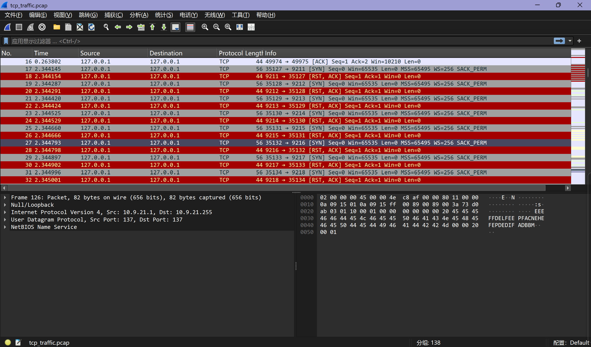

作为新手，我们大概会一脸懵，谁家五色旗跑出来了？


因此我们需要先大致了解各部分的含义 

上部分面板上显示的是数据包发送接受的各种要素

1 **No. & Time**  序号和持续时间

2 **Source & Destination** 来源和目的地

3 **Protocol**  协议，你可以把它理解为一种接头语言

4 **Length**  发送长度

5  **Info**  对话暗号和暗语 

[SYN]：喂，在吗？（发起连接）

[SYN, ACK]：在，你说。（同意连接）

[PSH, ACK]：这是我要给你的数据！（数据送达）

[FIN, ACK]：我说完了，拜拜。（正常挂断）

[RST, ACK]：别说了，挂断！（强制重置，通常发生在端口拒绝连接时）


左下部分告诉的是我们数据包详情

Frame 10：告诉你这个包有多少字节，什么时候被抓到的（这是“物证标签”）。

Null/Loopback：因为是自己跟自己通话（127.0.0.1），不需要经过真实的物理网卡，所以用了这个特殊的“虚拟信封”来封装。

Internet Protocol Version 4：露出了真实身份（192.168.100.1 -> 192.168.100.255）

每一层都可以折叠展开，这就是 Wireshark 最强大的地方——穿透协议栈，直击数据灵魂


右下部分是十六进制/ASCII 面板


知道这些之后我们就可以动手寻找宝藏了，可以发现前面的几十条数据无什么具体含义

直到44号

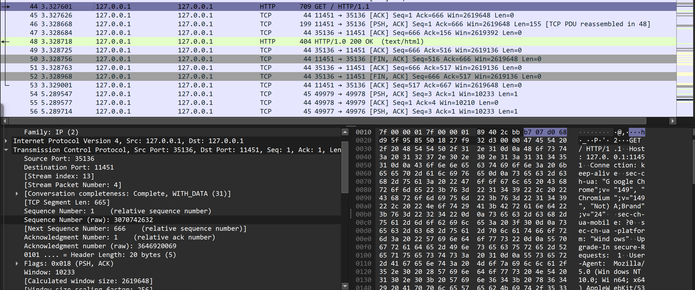

它开始在浏览器中搜索网页

接着48号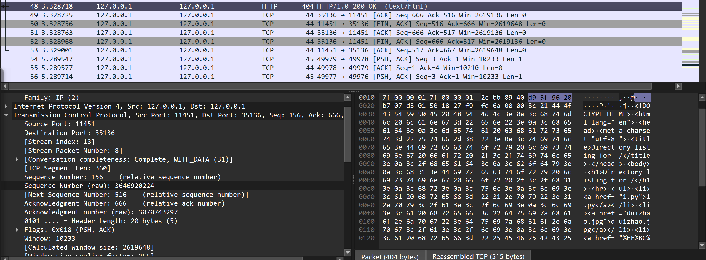

索取的html出现了，而这正是解题关键，里面包含了对照表图片和一个压缩包%EF%BC%9F%EF%BC%81raputa%EF%BC%81%EF%BC%9F.zip，页面的404与200 OK正是破绽所在

63-76号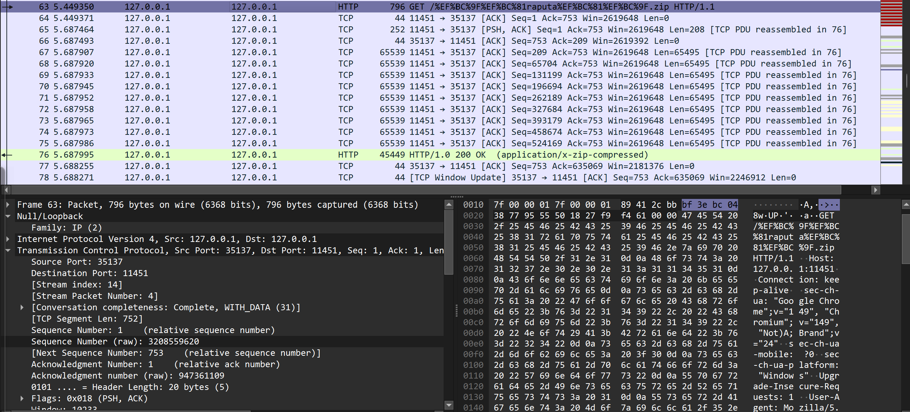


开始下载压缩包

115号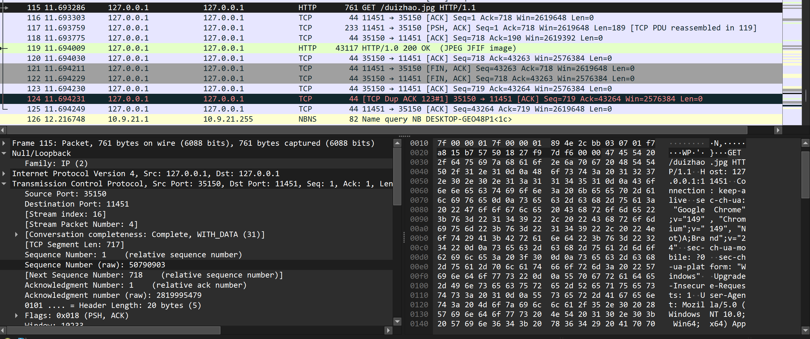

开始下载对照表

我们已经确定了，下载操作是通过http，和下载内容，那我们只用点击wireshark顶部的文件按钮，导出对象http

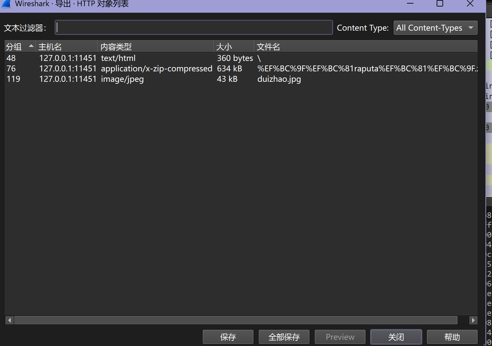

全部保存

得到 [？！raputa！？.zip](%EF%BC%9F%EF%BC%81raputa%EF%BC%81%EF%BC%9F.zip) 

解压压缩包


> Hint：
> 关于石板上的文字，其属于古波斯楔形文字（Old Persian Cuneiform），Unicode 区块 U+103A0–U+103DF。
> 这是一种半音节文字，每个楔形符号代表一个「辅音 + 元音」的组合音节。
>
> @w@不过这些不重要，你只需要知道，CD并不懂这些语言，他只是想到了一种简单且特殊的隐写对照模式，根据对照表一一对应写出了想传达的信息。
>
> 你问我对照表在哪？TAT我记得我发过了

接下来就是繁琐的解谜环节

得到

ma ya sa ta i ca 
sa ca  ra i pa ta
i na
ra a pa u ta a

最后按照要求得到**moectf{MYSTIC_SCRIPT_IN_RAPUTA}**

梗出处 raputa是sakura uk的作品【"raputa" sasakure.‌UK × TJ.hangneil [maimai でらっくす]】 https://www.bilibili.com/video/BV1KH4y1C7rA/?share_source=copy_web&vd_source=88870222ba0485ca94ee4f58f496b4f8

作品中出现神秘文明和人类的又一次大失败,视频包含了楔形文字元素

术曲方面我不太了解sakura uk,但曲风试了一下还蛮对胃口

### 基米文件 WP

> 哈基米哦南北绿豆~
> 哈希噶啊库奶龙~
>
>  附件：**hachimi.zip**（题目提供的压缩包） 

本题考查压缩文件里的文件隐藏和零宽字符，

先用7z检验压缩包全部内容

> 7z l hachimi.zip
>
> 7-Zip 23.01 (x64) : Copyright (c) 1999-2023 Igor Pavlov : 2023-06-20
>  64-bit locale=C.UTF-8 Threads:16 OPEN_MAX:10240
>
> Scanning the drive for archives:
> 1 file, 4125 bytes (5 KiB)
>
> Listing archive: hachimi.zip
>
> --
> Path = hachimi.zip
> Type = zip
> Physical Size = 4125
> Embedded Stub Size = 1280
> Characteristics = Local Central
>
>    Date      Time    Attr         Size   Compressed  Name
> ------------------- ----- ------------ ------------  ------------------------
> 2026-09-13 17:06:11 .....         2469         1214  fix.yaml
> 2026-09-13 16:55:33 .....        29286         2673  hachimi.txt
>
> ------------------- ----- ------------ ------------  ------------------------
> 2026-09-13 17:06:11              31755         3887  2 files

fix.yaml

> method: insert
>
> index: 618
>
> char: 200b
>
> key: hachimi
>
> author: xiaobaozi
>
> comment: 啊啊啊啊啊饱饱你是一个变量，常量，数据类型，整型，浮点型，字符型，布尔型，数组，字符串，结构体，联合体，枚举，指针，引用，运算符，算术运算符，关系运算符，逻辑运算符，位运算符，赋值运算符，表达式，语句类，对象，属性，方法，封装，继承，多态，抽象类，接口，重载，覆盖，泛型，模板，异常，错误处理，调试，断点，数组，链表，单链表，双链表，循环链表，栈，队列，顺序队列，循环队列，优先队列，树，二叉树，二叉搜索树，平衡二叉树，红黑树，堆，大顶堆，小顶堆，图，顶点，边，有向图，无向图，邻接矩阵，邻接表，深度优先搜索，广度优先搜索，哈希表，散列表，哈希函数，冲突解决，开放地址法，链地址法，算法，时间复杂度，空间复杂度，冒泡排序，选择排序，插入排序，希尔排序，归并排序，快速排序，堆排序，计数排序，桶排序，基数排序，查找算法，顺序查找，二分查找，哈希查找，动态规划，贪心算法，分治算法，回溯算法，白盒测试，黑盒测试，灰盒测试，回归测试，压力测试，性能测试，冒烟测试，极限编程，瀑布模型，螺旋模型，垃圾回收，引用计数，标记清除，分代收集，内存泄漏，缓冲区溢出，空指针，野指针，序列化，反序列化，密钥管理，密钥交换，遗传算法，遗传编程，蚁群算法，单例模式，工厂模式，抽象工厂模式，建造者模式，原型模式，适配器模式，桥接模式，组合模式，装饰器模式，外观模式，享元模式，代理模式，责任链模式，命令模式，解释器模式，迭代器模式，中介者模式，备忘录模式，观察者模式，发布订阅模式，状态模式，策略模式，模板方法模式，访问者模式，空对象模式，规格模式，依赖注入，控制反转，面向切面编程，断言，单元测试，集成测试，端到端测试，健全测试，探索性测试，硬件令牌，软件令牌，生物识别，指纹识别，量子算法，，数字签名迁移，密钥交换迁移，证书体系更新，密码敏捷性，密码破解，暴力破解，字典攻击，彩虹表，侧信道攻击香香软软的小蛋糕啊

hachimi.txt

> 哈米哈哈米基哈米哈米基哈哈米哈哈哈基哈米哈米基哈哈米哈基米基哈米哈米基哈哈基米米基哈米哈米基哈米米哈基哈米基基基哈基哈米米基米米哈米基基基米基哈米哈基哈米基基基米基哈米基哈基哈哈米基哈米哈米基米哈基哈米基哈米哈基哈米基哈基哈基米基哈米哈米基哈米哈米基基哈米哈米米哈米米哈哈米哈米基哈米哈基基基米基基哈哈基哈米哈米哈基米哈基哈米基哈基哈米基基米米哈米米基哈米哈米基哈基基米基基哈米基哈基基哈基哈基哈基哈米哈米基米基米米哈米基哈基米基哈米基米米哈米基基哈米基哈米哈基哈米基哈基米基哈米哈哈基基哈米哈米哈米米米基哈基基哈米基哈米基哈基基哈基基哈米基哈米哈米基哈基米哈基哈米哈米基哈米基基米基基基基基哈米哈米基米哈米基基基哈基哈米哈基基米米基哈哈基哈米哈米基米哈米基哈基哈基哈米哈哈米哈基米基哈米哈米基哈哈哈基基哈米哈米哈米米米基哈基哈基哈基哈米哈米基米米哈哈米哈米基基哈米基米米哈哈米哈米基哈米米基基哈基哈哈基基哈米哈米基米基米米哈米基基米哈基哈米哈基基哈基基哈米基哈米哈米哈哈基基哈米哈米基哈米哈基基哈基基米哈基哈米米基米米哈米基哈米基基哈米哈基哈米基哈基基基哈米基米哈米基基哈哈基哈米哈哈米哈米哈基哈米基哈基基米基米米哈米米米哈哈基哈哈米哈哈哈基哈米哈米基基米基米米哈米米米哈米基哈基基米基哈基哈基哈米哈米米基哈米基米哈哈基哈哈基哈哈米米哈基哈米基哈米米基哈米哈米哈哈米基哈米哈米基哈哈基米米基哈米哈米哈米米哈哈基基哈米哈米基哈基基基哈基哈哈米基哈米哈米基哈基米哈基哈米哈米基哈哈基米哈米基基基哈基哈米哈米哈基哈米基哈米哈基哈米米米哈哈米哈米基哈米哈基米哈基哈米基基哈米基哈米基哈基哈米米基哈米基哈基米哈基哈米米基哈基基哈米哈基米哈基哈米哈米基哈基哈基米基基哈米哈米基基哈基基米基基米基基哈米基哈哈基米基基哈米哈米基基哈哈哈基基哈米哈米基哈米基哈米哈哈米基哈米哈米基哈基米哈哈基基哈基基哈米基米米哈哈米哈米基基哈米基基哈基哈哈米基哈米哈米基米基米米哈米基哈米哈基哈米米哈哈米哈米基基哈米基哈基米基基哈米哈米基哈哈米米哈哈米哈米基哈米哈基米米哈哈米哈米基基米米基哈基米哈基哈米哈米基哈哈基基米米哈米米基哈米哈米哈哈基基哈米哈米基哈基哈哈米哈基哈基哈米哈米基哈米米哈哈米哈米基哈米哈基哈基米哈基哈米哈米米基哈哈米哈米哈基哈米基哈基基米基米米哈米基基基基基哈基哈基基哈基基哈米哈米基米基米米哈米基基米哈基哈基米哈哈基基哈米基哈米基基米哈米基哈基基基哈米哈基基米基哈米哈基哈米哈米米米哈哈米哈米基哈米米基米米哈哈米哈米基哈米哈基基米哈米基基哈基基哈米哈基米哈米基哈基基基哈米哈基哈基哈米基基哈米哈米米米米哈哈米哈米基基米哈基米哈米基米哈哈基哈哈基哈哈米米哈基米米基哈米哈米哈米米米基米米哈米基基哈米基哈米基米米哈米基哈米哈基哈哈米哈哈基基哈米哈米基哈米哈基哈米基哈米米基哈米米哈基哈米基基基米基哈米米基米米哈米基基基哈基哈哈基米哈基哈米哈米基基哈基基米基基米米基哈米基哈哈基米基基哈米哈米基哈哈基哈基哈米基基哈米基哈基哈哈基基哈米哈米基哈基基基基米基哈基哈基哈米哈米哈哈基基哈米哈米米哈基基哈基米米基哈米基哈基基哈米哈基哈米基哈米哈基哈米基基米基基哈哈基哈米基哈哈哈基基哈米哈米基基哈哈哈米哈哈基基哈米哈米基哈哈哈基基哈米哈米哈米米米米米哈哈米哈米基基哈米基哈米哈哈米基哈米哈米基哈米米哈哈米哈米基哈米哈基米基米米哈米基基哈基基哈米基米米哈米基基基米基哈米哈基哈米基基基哈基哈米米米哈哈米哈米基基米哈基基基米基基基基基哈米哈米米米哈哈米哈米基哈米基基基基米米哈米米基哈米哈米基基米基基基哈基哈米基哈米哈基哈米基哈米基基哈米米哈基哈米基哈基基基哈米哈哈米哈基哈哈米米基米哈哈哈基哈米哈米米基哈米基哈基哈基基米基哈基哈基哈米哈米基哈基基米基基哈米基哈基米基米米哈米基哈米基基哈哈哈基基哈米哈米哈米米基哈哈基基哈米哈米基哈基基哈哈基基哈米哈米哈米米米米哈基哈米基哈基米基哈米哈基米哈基哈米哈米基哈基基基米基基基基基哈米哈米基米哈米基基哈基基哈米哈基哈米哈米米哈基哈哈米米基米哈基基米基基哈米基哈米哈米哈哈基基哈米哈米米哈基米基基米基哈哈米基哈米哈米哈哈米哈基哈哈米米基米哈哈哈哈哈哈基基哈米哈米哈米米米哈米基哈基哈哈基基基米米基米米哈基米基基哈米基哈基基哈基米基哈基基基哈哈哈基米基哈基哈米哈米哈基哈米基哈基哈米米基哈哈基基基基基哈哈哈基哈米米哈哈米基哈基基基基基基哈米米米哈哈哈基哈基米哈基基米米哈哈米基哈基米哈哈基基米哈米基哈基米基哈米哈基基米基哈哈米基哈米哈米米哈基哈米基基哈哈基哈米基哈基基哈基基哈米哈米基米米哈哈米哈米基基基米基基米哈米基基基哈基哈米哈基基米基基基哈基哈米哈米米米哈哈米哈米基哈米基基基哈基哈基哈基哈米哈米基基米哈米基哈米基基哈米哈基米哈米基哈米哈基哈米哈米基米米哈米基哈基米基哈米米哈哈米哈米基基基基基哈米哈哈基基哈米哈米基哈哈米基米基哈基哈哈米米基基米米哈基米米基哈米基哈基基基米基米米哈米基哈米基基哈哈米哈哈哈基哈米哈米基哈米米哈哈米哈米基基基哈基米米哈哈米基哈基基基米基基基米基哈基哈基哈米哈米基哈基基哈米基哈米基哈基米基米米哈米基基米哈基哈哈哈基基哈米基哈基基哈米米基米米哈米基基米基基哈基米哈米基基基哈基哈米哈米哈基哈米米基哈米基哈米米米哈哈米哈米基哈米哈基基米哈米米基基基基哈米哈基哈基哈哈米基哈米哈米基基米哈米基哈基基基哈米哈哈基米基基哈米哈米基哈基哈哈基基哈米哈米基哈哈哈哈基米米基哈米哈米哈米米米米哈哈米哈米基基米基基哈哈基基哈米哈米哈米米米米基米米哈米基哈米哈基哈基哈基哈米哈基哈米哈米基基米哈米基哈基米基哈米哈基哈基哈米基基哈米基哈基哈哈基基哈米哈米基哈基基米基米米基哈基米基哈基哈米哈米基米哈基哈哈哈基哈哈米米基哈基基米基基哈米基哈基哈基米米基哈米哈米米基基基基米基哈基哈基哈米哈米基米哈米基哈基米基哈米哈米基米米哈米基基哈哈基哈哈哈基基哈米哈米基哈哈哈基基米基哈哈米基哈米哈米哈基米米基哈米哈米基哈基米哈基哈米基哈基米基哈米哈哈基基哈米哈米哈米米米哈基米米基哈米哈米基哈米哈基米基基哈米哈米基哈哈米哈基哈米基哈基基基哈米哈基米哈基哈米哈米基哈米基基米基哈基哈基哈米哈米基哈基哈基哈基哈米哈米基哈哈基基哈米哈米基哈哈米哈哈米哈基哈哈米米基米哈哈基米哈哈基基哈米基哈基基哈米基哈米哈米米哈基哈哈米米基米哈米基米米基哈基米基哈基哈哈哈基基哈米哈米基哈哈哈哈哈基基哈米基哈基哈基基米哈基哈米基基哈哈基哈米米基米米哈米基哈米哈基哈哈基米哈基哈米哈米基哈哈哈基米基基哈米哈米基哈基哈哈基基哈米哈米基哈哈哈基米哈米基哈基哈基哈米哈米哈基哈米基基米哈基哈米哈米哈哈基基哈米哈米基哈基哈基哈米基基哈米哈米米米米哈哈米哈米基基哈米基米米哈哈米哈米基基哈哈基基哈基哈哈基基哈米哈米基哈基米基基哈米哈米基哈基米米哈哈米哈米基基米哈基基基米基基哈基基哈米哈米基基米基基米米基哈米基哈基米哈米基基基基基哈米哈基哈基哈哈米基哈米哈米基基基米基哈基哈基哈米哈米哈基米基基哈米基哈基基哈基米哈米基哈基米基哈米哈米哈基哈米基哈基基基哈米基米哈米基基哈基基哈米哈基米哈哈基基哈基基哈米基基米哈米米基哈哈基哈米哈哈基米米基哈米哈米基哈米哈基哈基哈基哈哈米米基基米米米米米哈哈米哈米基哈米哈基基哈米哈基基哈基哈哈米米基米哈哈哈基基哈米哈米哈米米米米基米米哈米基哈米哈基哈哈基米哈基哈米哈米基哈基基哈基基哈米基哈米哈米基哈哈基基哈米哈米基哈基米哈哈基基哈米哈米基哈米米米米哈哈米哈米基基米哈基米基米米哈米基哈米基基哈基基米基哈米米基哈米基哈基基米基哈米米基哈米哈米哈基米哈基哈米哈米基哈哈哈哈基基哈米哈米基哈哈哈米基米米基哈基基米基基哈基基哈哈哈哈基哈基哈哈米米基米米哈基基哈基基哈基基哈米基基哈哈基哈哈哈基哈哈米米基米米哈基基哈基基基哈基哈米米基米米哈米基哈米哈基哈米哈基哈米基基哈哈基哈米哈基米基基哈米哈米基哈哈米基米米哈米基哈基米基哈米米哈哈米哈米基基哈米基哈基米米基哈米哈米基哈米哈基米基基哈米哈米基哈米基哈基基哈基基哈米哈米基米哈基哈米基基米哈基哈米基米哈米基哈基基基哈米哈哈基哈哈哈基哈哈米米基基米米米基米哈米基哈米基基哈米哈米哈基哈米米基哈米基哈米米哈基基哈基基哈基基哈米基基米基基哈哈基哈米哈米哈哈基基哈米哈米哈米米米米基米米哈米基哈米哈基哈哈米哈米基基哈米基哈基基哈哈基基哈米哈米基哈哈哈基基米基基哈哈基哈米基哈哈米哈米哈基哈米哈米基哈米哈基基哈基基哈米基哈米哈基米哈基哈米哈米基哈哈米哈基哈米基哈米米基哈米基米哈米基基基米基哈米哈哈哈基基哈米哈米基哈基米米基米米哈米米米哈米基哈哈哈基基哈米哈米基哈米基基基哈哈哈哈基哈基哈哈米米基米米哈基哈米基哈基基基哈米基基哈哈哈基基哈基哈哈米米基米米米哈哈米哈米基哈米基基基哈基哈哈米基哈米哈米基米基米米哈米基基哈基基哈米哈基哈米基哈米哈基哈米基基米基哈米米基哈米基哈米哈基哈米基基基米基哈米哈哈基基哈米基哈基哈基米哈哈基基哈米哈米哈米米米哈哈基基哈米哈米基哈基哈米米哈哈米哈米基基哈哈基基基米基哈米米基哈米基哈基哈米哈基哈哈基哈哈米米基米哈基米哈米基基基哈基哈米哈哈基米米基哈米哈米基哈米哈米哈哈哈基哈米哈米基基米基米米哈米基基米基基哈哈米哈哈基基哈米哈米基哈基米哈米基哈基基基哈米哈哈基米哈基哈米哈米基哈基基米哈米基哈基米基哈米哈哈基米米基哈米哈米哈米米哈米哈米哈基哈米哈米基哈米基米米哈米基哈米哈基哈基哈基哈哈米基哈米哈米基米基米米哈米基基基米基哈哈基米米基哈米哈米基哈哈基基米基哈哈米基哈米哈米米基米米哈米基基基哈基哈哈基米基基哈米基哈基哈米米基哈米基米哈哈基哈哈基哈哈米基哈基哈基米基哈米哈米基米哈米基米哈基哈米哈基哈哈米米基基米基基哈哈基哈米哈米米哈基哈米基基基米基哈米米米哈哈米哈米基基米哈基米哈基哈米基哈米哈基哈米基哈基哈哈基基哈米哈米基哈基米基基哈米哈米基哈基哈米哈哈基基哈米哈米基哈哈基米哈基哈米哈米基哈哈哈哈基基哈米哈米基哈基哈米基米米哈米基哈米米基哈基米哈米基哈基哈基哈米哈基米哈米米米哈哈基哈米哈哈哈基基哈米哈米哈米米米基基米基哈基哈基哈米哈米米哈基哈米基基哈哈基哈米基基哈哈哈哈基哈基哈哈米米基米哈哈基基哈米基哈基哈基基基哈基哈米哈基哈米哈米基基哈基基哈基基哈米哈米基基基米基基哈基基哈米哈米基哈基基米基基哈米基哈基哈哈基基哈米哈米基哈米米哈哈基基哈米基哈基哈基米哈哈基基哈米哈米哈米米米哈米哈哈米基哈米基哈基基米哈基哈米基哈米基基哈米米哈基哈米基哈基基基哈米哈哈基基哈米哈米米基哈哈米哈基哈米基哈基米基哈米米哈米基米哈哈哈米哈基哈哈米米基基米基基哈米基哈米哈米哈基哈基哈基哈哈米米基基米米米哈基米米基哈米哈米哈米米米哈基哈米基基哈基基哈米基哈基哈哈米基哈米哈米基基基米基哈基哈基哈米哈米哈基米哈基哈米哈米基哈基米哈基哈米基基基米基哈米哈哈基基哈米基哈基基哈米基基米基基基哈基哈米哈米米米哈哈米哈米基基米哈基米哈基哈米基哈米基基哈米哈米哈米基基哈米基哈基哈基基米米基基哈基哈米哈米米基米米哈米基哈米哈基哈米哈米基米哈哈哈米哈基哈哈米米基哈基哈米哈基哈米哈米基米米哈哈米哈米基基哈哈基哈米哈哈哈基哈米哈米基哈哈米哈哈基基哈米哈米基基米米哈哈米哈米基哈米基基哈米哈哈基基哈米哈米基哈哈米哈基米基哈米哈米基哈米米哈哈米哈米基哈米米基米基米米哈米基哈基米基哈哈米哈基米基哈米哈米基哈基哈基基哈基基哈米哈米基米基米米哈米基基基米基哈米米哈哈米哈米基基米哈基米米哈哈米哈米米米基哈基哈哈基基哈米哈米哈米米米哈米哈哈米基哈米哈米基哈基哈基基哈米基哈米基哈基米米哈哈米哈米基基哈哈基哈米哈米基基哈米基哈基哈哈哈基基哈米哈米基哈基基哈米哈米基基哈米基哈基哈米哈基哈米基哈基米基哈米哈基米米基哈米哈米基哈米哈基米基基哈米哈米基哈哈基基米基哈哈米基哈米哈米哈哈基基哈米哈米基哈基基哈基米哈基哈米哈米基哈哈哈基米基基哈米哈米基哈哈米基米米哈米基基哈哈基哈哈基米基基哈米哈米基基哈基哈基哈米米基哈米哈米基基基哈哈基哈哈哈基哈哈米米基米哈哈基基哈米哈米基哈米基米米基米米基米哈哈基米哈基哈哈哈米哈哈哈基哈米哈米基哈基哈基哈米哈基哈米哈米基基基米基基哈哈基哈米基哈哈米哈哈基基哈米哈米基哈米米哈哈米基哈基基米米基哈哈基基哈米哈米基哈哈哈哈基米米基哈米哈米哈米米哈米哈哈基基哈米哈米基基基基米基基哈基基哈米基哈基基米基哈基基基哈米哈米哈米哈基米基哈米哈米基哈米米基米米基米哈哈基米哈基哈哈基哈基哈哈基基哈米哈米基米基米米哈米基基哈米基哈基基米基基哈米基哈米哈米米哈基哈米基基基哈基哈米基哈基基哈基基哈米哈米基哈米哈哈基基哈米哈米基基哈哈基基哈米哈米哈米米米基哈基哈哈米基哈米哈米基米米哈哈米哈米基基哈基基米哈基哈米基哈米哈基哈米基米哈米基哈基哈基哈米哈基哈基哈米基基哈米哈米基基哈基哈米米基哈米基哈基基米哈米基哈基米基哈米哈米哈基基哈基米哈基基哈米哈基米哈基哈米哈米米哈米基哈基哈哈基基哈米哈米基米米基米米基米哈基哈哈哈基哈哈米米哈哈米基哈基基基基基基米基米哈哈哈基哈基哈哈米米基基米哈哈基基基基基哈米基基米哈米基基基基基哈米哈米基米米哈米基基基哈基哈哈米哈哈基基哈米哈米基基哈米哈哈哈基哈米哈米基基哈哈基基哈米哈米基哈哈哈哈米哈哈哈基哈米哈米基哈哈基米基基哈米哈米基哈基米米哈哈米哈米基哈米基基基哈基哈基哈基哈米哈米基哈哈基基哈米哈米基哈基哈哈哈基基哈米哈米基哈哈基基基米基哈哈米基哈米哈米基基哈哈基哈哈哈基哈哈米米基米米基米米基哈基基基哈基哈哈米基米基哈基哈哈米米基基米米米米哈哈米基哈基基米米基哈基米基基哈米哈米基哈哈基米哈米基哈基哈基哈米哈哈基米基基哈米哈米基哈基米哈基基哈基米哈基基哈米基基米基基哈基基哈米哈米基哈基基哈基基哈米哈米基米哈基哈米基基基米基哈米哈米哈哈基基哈米哈米基哈哈米哈哈米基哈米哈米基哈哈米哈基基基哈米哈米基哈基米基米哈哈哈米哈基哈哈米米基米基米米哈米基哈基米基哈哈基米哈基哈米哈米基哈米哈米哈哈基基哈米哈米基哈基米哈米基哈基基基哈米哈哈基米米基哈米哈米基哈米基哈基哈基哈基哈米哈米基基米哈米基哈基哈基哈米哈米哈基哈米基基哈基基哈米哈米哈米基基哈米基哈基哈哈哈基基哈米哈米哈米米米哈米哈哈基基哈米基哈基基基哈基基哈米基哈米哈米基米米哈哈米哈米基基基基基基哈基基基哈基哈米哈米基哈哈基基哈米基哈基基基米哈米哈米基基哈米哈米米哈基基米基哈哈米基哈米哈米哈米哈哈基基哈米哈米米基基哈基哈哈米基哈米哈米基基哈基哈哈米基哈米哈米基基哈基哈米哈基哈米哈米基基米哈米基哈基米基哈米哈哈哈基基哈米哈米哈米米基基基米基基基哈基哈米哈米基哈基哈哈米基哈米哈米基基米哈米基哈基基基哈米哈米米哈哈米哈米基基哈米基米米哈哈米哈米基哈米米基哈米哈哈哈基哈米哈米基哈基哈基哈米基基哈米哈米基基哈基基哈基基哈米哈米基哈哈基基哈米哈米米基哈米基基米基米哈哈基哈米基哈哈米哈哈米基哈米哈米基基米哈基基哈基基哈米基哈米米基米米哈米基哈米基基哈哈米哈基基基哈米哈米基哈基基哈基哈米哈哈基哈哈米米基米基米哈哈基基哈哈基哈米基哈米哈米哈基哈米哈米基哈基哈基哈哈米基哈米哈米基米米哈哈米哈米基哈米基基基哈基基哈基基哈米哈米基基米哈米基哈基米基哈米哈米哈基哈米基哈基基基哈米基米哈米基基哈哈基哈米哈米基米米哈米基哈米哈基哈米哈基哈米基哈米哈基哈米哈基米哈基哈米哈米基哈基哈哈基基哈米哈米基基哈哈基米哈米基基哈基基哈米哈米米基米米基米哈基基基哈基哈哈米哈基哈米基基基基基哈米基基哈哈哈哈基哈基哈哈米米基米米米哈哈米基哈基基基哈基基米哈米基哈米米基哈米哈米基米米基哈基基基基基哈基基米基哈基哈基哈米哈米米基米米基哈基基米基基哈哈基米基基哈米哈米基哈哈哈米哈米哈基哈米基哈基哈基米哈米基基基基基哈米哈基米哈米基哈基基基哈米哈基米哈米基哈基米基哈米哈基哈基哈米哈基哈米哈米基基哈基哈米米基哈米哈米米基哈基哈哈基基哈米哈米基基基米米基基哈基哈米哈米基哈基基哈基基哈米哈米基米哈基哈米基基基哈基哈米米哈基哈米基基基基基哈米哈基米哈基哈米哈米基基哈米米哈哈米哈米基哈米基基基哈基哈哈米基哈米哈米基米米哈哈米基哈基基米基基哈哈基基哈米哈米基哈哈哈哈米哈哈哈基哈米哈米基哈哈哈基基哈米哈米基哈基基基哈基哈米米基哈米基哈基哈米哈哈米基哈米哈米基哈基基米基基米米基哈米基哈基基米米基哈哈基哈米哈米基米哈哈基基哈基基哈米基哈米哈米基基哈米哈米基哈基基米基哈基哈基哈米哈米基基米基哈基基基哈米哈米基哈基哈基米基哈米哈米基米米哈哈米哈米基基米基基米米哈哈米哈米基基基基基米哈基哈米基基基米基哈米基基米基基哈米基哈米哈米米基米米哈米基哈米基基哈哈米哈哈哈基哈米哈米基哈基哈基哈米哈基哈米哈米基米米哈哈米哈米基哈米基基哈基米基基哈米哈米基哈哈米哈基哈米基基哈哈基哈米哈米哈米基基哈米哈米米哈哈米哈米基基哈米基哈基哈哈哈米哈基哈哈米米基米哈哈基米米基米米哈米基哈米哈基哈基基米基哈基哈基哈米哈米哈哈基基哈米哈米基哈基哈米基米米哈米基哈米基基哈哈基米米基哈米基哈基哈基米米哈哈米哈米基基哈米基基米哈米基基基哈基哈米哈基米哈米基基哈米基哈米哈哈基米米基哈米哈米基哈米米基米米哈米基基米哈基哈基米哈米基哈基基基哈米哈哈基米基基哈米哈米基哈哈米哈基哈米基哈米米基哈米基米哈米米基哈基基哈米哈基米哈米基哈基哈基哈米哈基米基米哈哈米哈哈基哈哈米米基哈米哈哈基基哈米哈米基哈基基米基哈基哈基哈米哈米基哈基基米基基哈米基哈基米哈基哈米基哈米哈基哈米米米哈哈米基哈基基基哈基哈米哈米哈基哈米哈米基哈哈哈基基哈米哈米哈米米米基基米基哈基哈基哈米哈米哈基米哈基哈米基哈基基哈基米哈米基基基基基哈米哈基基米基基哈哈基哈米哈米基基米基基基哈基哈米哈米基米哈米基基基哈基哈米哈哈米哈米基基哈米哈米米哈米哈基哈米基哈基基基哈米基基米基哈米基基哈米哈米基基米基哈基哈基哈米哈米哈哈基基哈米哈米基哈哈哈哈米哈基米基哈米哈米基哈哈基米基基哈米哈米基哈哈米哈基哈米基哈基基基哈米米米哈哈米哈米基基米基基基米哈米基哈基基基哈米哈米哈基哈米基哈基米基哈米哈哈基基哈米基哈基基哈哈基哈基哈基哈基哈米哈米基哈米哈米哈基哈米基哈基哈哈米哈米哈基哈米哈米基哈基哈基基米基基哈米基哈基基米基米哈哈米米哈基哈哈米米基哈基米米基哈米哈米基哈米米米基米米基米哈基基基哈基哈哈米米哈哈米哈米基哈米基基基基米基哈基基基哈米哈米基哈基哈基米基哈米哈米基米基米米哈米基哈米哈基哈哈哈基基哈米哈米哈米米基哈哈基基哈米哈米基哈基哈米基米米哈米基哈米哈基哈米哈基基哈基基哈基基哈米哈基米米基哈米哈米基哈米基基米基基哈哈基哈米基哈米米哈哈米基哈基基基哈基米基米米基哈基基米米基哈哈米哈哈基基哈米哈米基哈哈米哈哈哈基哈米哈米基哈哈哈基基哈米哈米基哈哈米哈哈基基哈米哈米基哈米基基哈基哈米米基哈米哈米基米基米米哈米基基基米基哈哈基米米基哈米基哈基基基哈哈基基哈米哈米哈米米米哈基米哈基哈米基哈基哈米米基米米基哈基基米哈基哈米米哈哈米基哈基基基基基基基米基哈哈米基哈米哈米米哈基哈米基基哈哈基哈米基哈基哈哈米基哈米哈米基基哈基哈哈基基哈米哈米基哈米哈哈哈基哈米哈米基基哈基米哈基哈米哈米基哈哈米基米米哈米基哈基米基哈基基米基基基基基哈米基哈哈米哈米米基哈米基哈基哈基哈基哈米米基哈米基哈基米哈基哈米基哈米米基哈米哈米哈哈哈基哈米哈米基基米哈基哈米基基哈米基哈米米哈基哈米基基基基基哈米米基米米哈米基基基米基哈米哈基哈米基哈基米基哈米米基米米哈米基哈基米基哈哈米哈哈基基哈米基哈基基基基米基基哈哈基哈米基哈米基米米哈米基哈基米基哈米哈基基哈基基米基基哈米基米哈哈基基哈米基哈米基基基米基哈哈米基哈米哈米基米哈米基基基哈基哈米哈米基米米哈米基哈米哈基哈哈基米米基哈米哈米哈米米基基米基哈米基基哈米哈米基基米基哈基哈基哈米哈米米哈基基哈基基哈基基哈米哈基米哈基哈米哈米基哈基哈基米米基哈米基哈基基基基基米基基米哈基哈米基哈哈哈基基哈米基哈基基基米基米哈米基基基哈基哈米哈基基米基哈基哈基哈米哈米哈哈基基哈米哈米哈米米基基米哈米基哈米基基哈米哈米米哈哈米哈米基哈米基基哈米哈哈哈基哈米哈米基哈米米哈哈米基哈基基米米基基基米基基哈哈基哈米基哈米哈基哈米基哈基基基哈米基基米基米哈哈基哈米基哈基米哈哈基基哈米基哈米基基米哈米基哈基哈基哈米哈基哈基哈米哈基哈米哈米基基米哈米基哈基基基哈米哈米基米米哈米基哈基米基哈基基米基哈米哈基哈米哈米基米哈米基基基哈基哈米哈哈基米哈基哈米基哈基基基基米哈米基基基哈基哈米哈米米哈哈米基哈基米基基基哈基米哈基哈米基哈基哈米哈基米哈基哈米基哈基哈米基哈基哈基米基哈米哈米基米哈基哈米基哈基米基哈米米哈基哈米基哈基基基哈米哈基米基基哈米哈米基哈基米哈基哈米基哈基米基哈米哈米哈哈哈基哈米哈米基哈基哈基基哈基基哈米哈米基米米哈哈米基哈基基基基基基哈基哈米米基哈米基哈基米哈基基哈基基米基基哈米基哈基哈哈米基哈米哈米基米基米米哈米基哈基米基哈基基米基哈米哈基哈米哈米基基米基基哈米基哈米哈米米哈基哈米基基哈米基哈米基哈基基哈基基哈米哈米基哈米哈哈哈基哈米哈米基基米基米米基哈基基基哈基哈哈基米米基哈米哈米哈米米基米哈哈基基基基基哈米基米米哈哈米基哈基基基基基基哈基哈米米基哈米基哈基米基米米哈米基基哈基基哈基米哈米基哈基基基哈米哈米哈基哈米基哈基基基哈米米基米米哈米基基基米基哈基基米基哈基哈基哈米哈米基基米基哈哈米基哈米哈米米米哈哈米基哈基基米米基基基米基基哈哈基哈米基哈基米哈米基哈基哈基哈米哈基米哈哈基基基米基哈米基哈基米米基哈米基哈基基基米基米米哈米基基基哈基哈米基米米哈米基基基米基哈哈哈基基哈米哈米基哈米基哈哈基基哈米哈米哈米米米米米哈哈米哈米基哈米哈基哈米哈基基基哈米哈米基哈基基米基哈基哈基哈米哈米基哈基哈米基基哈米基哈基哈哈基基哈米基哈基基哈基基基米基基哈基基哈米基哈哈米哈哈哈基哈米哈米基哈哈哈基基哈米哈米基哈米基米米哈哈米哈米基哈米基基哈基米米基哈米哈米哈米米哈基米基基哈米哈米基哈基米基米米哈米基哈米哈基哈米基米米哈米基哈基米基哈哈哈基基哈米基哈基哈米米基哈基基哈基基哈米哈米基哈米哈基米基哈米基哈基基哈米哈哈哈基哈米哈米基基基米哈米基基基哈基哈米哈米哈基哈米基哈基米基哈米基哈基哈哈基基哈米哈米基基基米基哈米哈基哈米哈米基基米基哈基哈基哈米哈米米基米米哈米基哈基米基哈米米哈哈米哈米基基哈米基哈米哈米基基哈米基哈基哈基基米基哈米米基哈米基哈基基米基基哈米基哈米哈米米哈基基哈基基基哈基哈米基米哈米基哈基哈基哈米哈米基米米哈米基基哈基基哈基哈基哈哈米基哈米哈米基基哈基哈哈基基哈米哈米基基基米基哈米哈基哈米哈米哈米哈哈哈基哈米哈米基基基哈基哈米米基哈米哈米基基基米基基米米基哈米基哈哈基米米基哈米哈米基哈米基哈基基哈哈基哈米基哈基基哈基哈哈基基哈米哈米基基基米基基基基基哈米基哈基哈基哈哈米基哈米哈米基哈米哈哈哈基哈米哈米基哈哈米哈基米基哈米哈米基哈米米哈哈米哈米基哈米基基米哈基哈米基哈基基基哈米基基米基基哈米基哈米哈米基米哈米基哈基基基哈米哈基哈基哈米基基哈米基哈基哈米哈基哈基哈米基哈基基米米哈哈米基哈基基基米基米基米米基哈基基哈米基哈米米哈哈米哈米基基哈基基米基米米哈米基基基米基哈基哈基哈米米基哈米哈米基基基米基基哈米基哈米哈米基米哈米基基基哈基哈米哈基哈基哈哈米基哈米哈米基哈米哈哈哈基哈米哈米基哈基哈基基哈米基哈米基哈基哈米哈哈基基哈米哈米基哈米哈基基哈基基哈米基哈米哈基米基基哈米哈米基哈基哈基米哈基哈米哈米基哈哈哈哈基基哈米哈米哈米米基哈哈基基哈米哈米基哈米基基哈基哈哈米基哈米哈米基米哈基哈米基哈基基基哈米米哈基哈米基基哈哈基哈米基米哈哈基基哈基基哈米基米基米米基哈基基哈米基哈基哈基基哈米基哈米基哈基哈基米哈基哈米基哈基基米基哈基基米哈基哈米基哈基

由**fix.yaml**得到关键信息，解码需要用到作者是xiaobaozi的哈基米语解码器，且key是hachimi

搜索得到[哈基米加密器](https://app.xiaobaozi.cn/?utm_source=chatgpt.com) 在曼波语框内复制hachimi.txt内容，私钥处输入hachimi

解码得到

> ‌‌‌‌‍‬‍⁢‬⁢‌‌‌⁢‌‍‬‌‍‌‌⁢‌⁢‌‍⁢‬‬‌‌‌‌‍⁢‬‍⁣‍‌⁣‌‌‌‍‬‍‬⁢‌‌⁣‌‌‍‬‌‌‌‌⁢‌⁢‍‬⁣‌⁣‍‌‌‌‌‍‬⁢‍⁣‌⁢‌‌‌‍‬眼⁢见⁢为⁢实⁣‌‌‌‌‍‍‍⁢‌‌⁣‌⁢‌⁢‍‬‬‌‌‌‌‌⁢‍⁣⁢‬‍‌‌‌‌‍‍⁢⁣‌⁢‌‌‌‍‬‍‌‌⁢‌‌⁣‌‍⁢‬‌‌‌‌⁢‍‍⁢⁢⁣‌‌‌‌‍‬⁢‍‌⁣‌⁣‌⁢‌‍‬‌‌⁢‌⁢‌‍⁢‍‍‌‌‌‌‍‍⁣‌‌‌‌‍‬‌⁢‌‌⁢‌⁢‌⁣‍‬‌‌‌⁢‌‍⁣‬‍‌‌‌‌‍‬‍⁢‍⁣‌⁢‌‌‌‍‍‌⁢‌⁢‌‌⁣‍‍‌‌‌‌‌⁢‍⁢‬⁢⁢‌‌‌‌‍‍⁢⁢‌‌⁢‌‌‍‍‌‌‌⁢‌⁢‌‍⁣‬‬‌‌‌‌‌‍‬⁣‍⁢‍？⁢‌‌‌‌‍‍⁢‌⁣‌⁢‌⁢‌‍‬‬‌‌‌⁢‌‌⁢‍⁢‬⁣‍‍‌‌‌‌‍‬⁣‌‌⁢‌‌‌‍‬‌⁢‌⁢‌‌⁢‌‌‬‌‍‌‌‌⁢‌⁢‍⁢‍⁢⁢⁢⁣⁢⁣⁢⁢⁢⁣⁣⁢⁢⁣⁣⁢⁢⁢⁣⁢⁢⁣⁣⁢⁣⁢⁣⁢⁣⁣⁢⁢⁢⁣⁢⁢⁣⁢⁢⁣⁣⁢⁣⁢⁢⁣⁢⁣⁣⁢⁣⁣⁢⁢⁣⁢⁢⁢⁣⁣

由fix.yaml猜测含unicode字符，先放到[Unicode 检查器 | 分析字符与码点](https://www.toolszone.net/zh/tools/unicode-inspector)里得到包含七种Unicode字符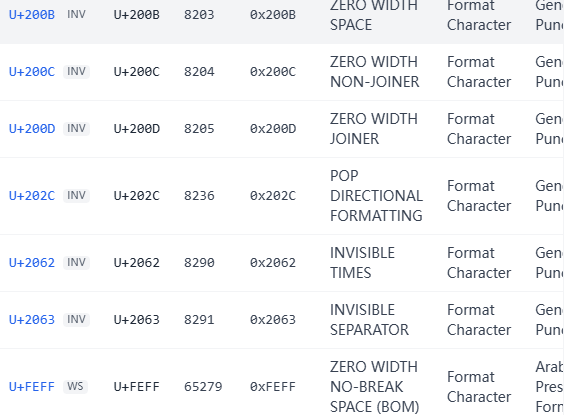

如果我们直接把文本放入[在线零宽字符unicode文字隐写工具-BFW工具箱](https://tool.bfw.wiki/tool/1695021695027599.html)里的话，得到假flag

**fakeflag{Why_do_you_come_to_the_hell!}**

因为这是它解码的是其中四种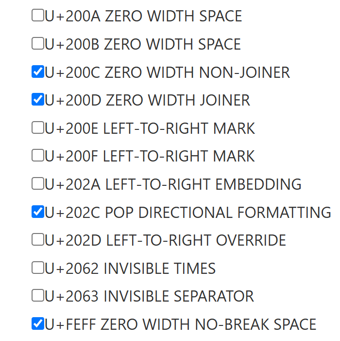

如果单独解码剩下的三种2062,2063,200b的话得到

**moectf{g00d_jo6_c0rpor@1_7ouĝĵ™ŜĝŜĸ™ĝř™ĩŖįœc}**

前半部分正常，后半部分乱码，证明尝试正确，这需要时候用到fix.yaml里的提示，insert（插入）

在618位再加入一个U+200b的字符

写脚本

```python
with open(path, "r", encoding="utf-8") as f:
    text = f.read()

text = text[:618] + "\u200b" + text[618:]

with open(path, "w", encoding="utf-8") as f:
    f.write(text)
```


得到新的内容，后复制粘贴到[在线零宽字符unicode文字隐写工具-BFW工具箱](https://tool.bfw.wiki/tool/1695021695027599.html)再次解码得到

**moectf{g00d_jo6_c0rpor@1_7ou_g3t_th3_s3cre4!}**

### **魔理沙偷走了重要的东西**

> 魔理沙从博丽神社"借"走了某样东西，留下了一张借条。
>
> 灵梦觉得这张借条有点不对劲——图片打开倒是正常，但这 800×590 的 PNG 足足有 600多KB，重得离谱……
>
> 你能帮灵梦找出魔理沙到底藏了什么秘密吗？
>
>  附件：**marisa.zip**（题目提供的压缩包，800×590 PNG 约 600+KB） 

本题是对前期misc的多方向考察

解压文件得到

放入010editor检测，看到有附加数据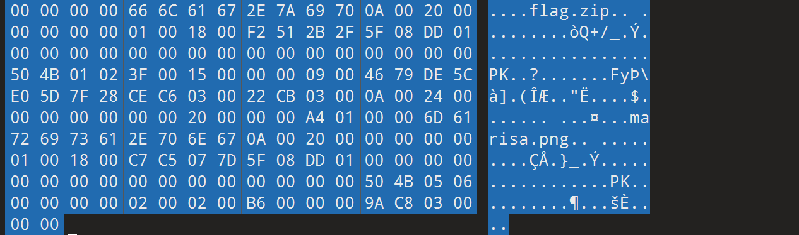

这时需要将数据切割出来，需要找到Marisa.png结尾处，用到文件结构知识

`PNG结尾构造IEND chunk = length(4) + "IEND"(4) + CRC(4) = 12 字节`

00 00 00 00        I E N D         XX XX XX XX
└─── 长度 ─┘  └─类型─┘  └── CRC ─┘

`Ctrl+F`搜索IEND，确定到结尾处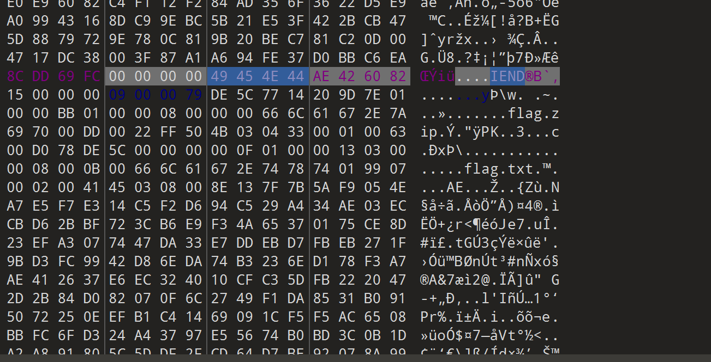

如果 ZIP 直接拼在 PNG 后面，ZIP 应该从 PNG 结束的位置就开始了，那第一个`PK\x03\x04` 应该在 IEND 之后紧接着出现

但实际上却出现在39字节之后，唯一的解释只能是PNG的CRC值覆盖了ZIP的前四字节

这就考察到了misc里经典的文件头改写

按 `→` 键 4 次后，按`Shift + Ctrl + End` 选中到文件末尾，右键 → Save Selection 

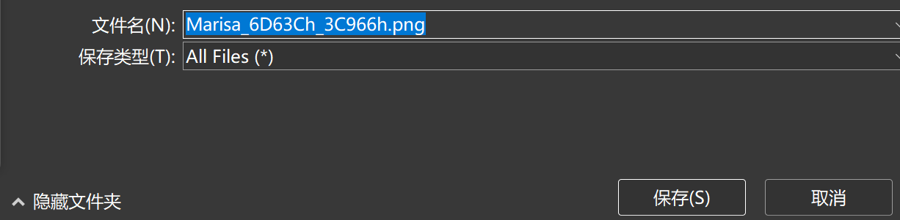


把png改为zip保存，得到压缩包之后再把文件头哈希值改为50 4B 03 04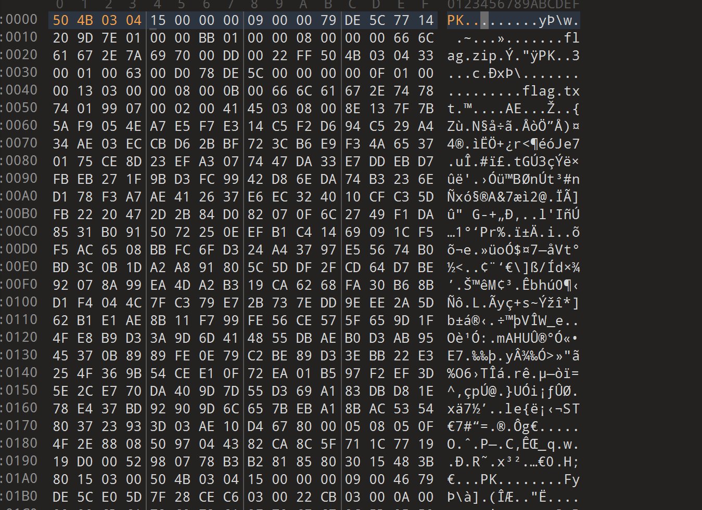

得到

和flag压缩包

先把魔理沙图片放到010editor里得到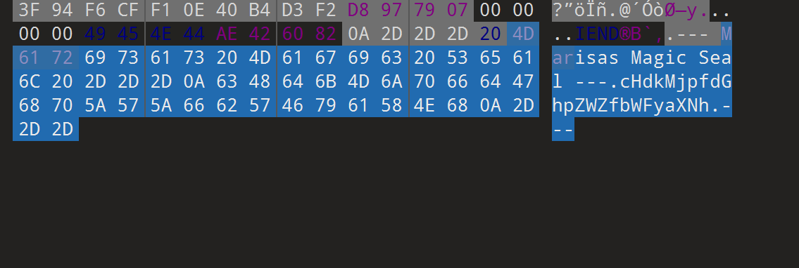

base64解码得到pwd2:_thief_marisa

再把图片放到随波逐流工具箱LSB检测器中得到pwd1:master_spark

密码为master_spark_thief_marisa

将密码输入后得到

>Marisas Hidden Treasure!
>+++++ +++++ [->++ +++++ +++<] >++++ +++++ .++.< +++[- >---< ]>-.- -.<++
>++[-> ++++< ]>+.< +++[- >---< ]>--- --.<+ +++[- >++++ <]>++ +++.< +++[-
>---< ]>--- --.<+ +++++ +[->- ----- -<]>- ----- --.<+ +++++ +[->+ +++++
>+<]>+ +++++ +++++ ++.-- ----- --.<+ ++[-> +++<] >+.<+ +++[- >---- <]>--
>.--.< +++++ +[->- ----- <]>-- ----- ---.< +++++ +++[- >++++ ++++< ]>++.
><++++ [->-- --<]> ----. <++++ [->++ ++<]> +++++ .<+++ [->-- -<]>- --.--
>-.--- ---.+ ++.<+ +++++ [->-- ----< ]>--- ----- ---.< +++++ +++[- >++++
>++++< ]>.+. <++++ [->-- --<]> ----- .<+++ +[->+ +++<] >++++ +.<++ +[->-
>--<]> ---.< +++++ ++[-> ----- --<]> ----- -.++. <++++ +++[- >++++ +++<]
>++.- ----- -.+++ ++.-- -.<++ +++[- >++++ +<]>. <++++ [->-- --<]> -----
>.<+++ +[->+ +++<] >++++ ++++. <

明显的brainfuck密码，使用[dcode](https://www.dcode.fr/brainfuck-language)得到

moectf{m4risa_1s_the_b3st_th13f_daze}

[字幕付]阁下的完美算数教室] https://www.bilibili.com/video/BV1RK411H7J6/?share_source=copy_web&vd_source=88870222ba0485ca94ee4f58f496b4f8)

### 西复问答WP

本题考查的主要是对未知信息的检索和穷举，如果用心搜的话其实挺容易解决

先看第一部分

> 西电b楼可从平地直接进入的楼层总和为？（答案格式 ^\s*\d+\s*$）

其实这题我作为xd学生也一脸懵，毕竟当时还没去过b楼探索，那么只能从地图入手


可以看到是南楼的1,2,3层，和北楼的4层

故答案为1+2+3+4=10

第二部分

>  这张照片是在哪所院校的哪栋楼的几层拍的？（答案格式 院校名楼名-层，如 复旦大学逸夫楼-1）


由题目可知整道题和xd和旦旦大学相关，故第二部分大抵是旦旦大学出题人负责，而复旦的光华楼就在较远的方向，故拍摄地不在复旦，但可以确定是上海大学城

确定方位：很明显拍摄时间位于傍晚，落日在左侧，故右侧为东向，向东望见复旦光华楼，故光华楼在拍摄地的东北方向。沿地图寻找，可大致确定是同济大学（上外距离太远排除）

接下来来找是什么楼，我在这里用了一个取巧的方法，附近的楼上的一排太阳能锅盖很明显，在卫星地图上找的话能看到同济的建筑与城市设计学院的教学楼与之相符

如图可知，拍摄位置很高，而建城学院附近的校内高楼只有赫赫有名的衷和楼，与附近的五角场丽芮酒店对比可知拍摄地楼层在10层以上，之后进行尝试，答案正是同济大学衷和楼-13

第三部分

> 西电湖人的发生时间？（答案格式yyyyddmm）

有所耳闻的新闻，现在浏览器上搜寻，泥电信息封锁（悲，没有完整事件链，去更隐秘的平台，很明显是贴吧这种，因此不得不注册贴吧号，去西电吧，搜索湖人，找到最早消息，时间显示为20230911!

尝试成功，答案正是20230911

flag    moectf{FuUUUU_xI1iIi_QU1Z2z2zz1fdecd4d}

既然说到上海，那就不得不提12月份，将要举办的Clamp展，我的沪人生活，你在哪里 


[返回目录](#目录)

---

## dev

### 当 Nginx 不在家WP

> 开发与运维基础

> 工具使用

> 没有 Python 的优雅，没有 Node.js 的庞大，甚至连最基本的 Web 服务器 Nginx 都不见踪影。林林叹了口气，下意识地敲下`ping bing.com`，得到的只有一句冰冷的 Network is unreachable。这里是一座数字孤岛，它被彻底切断了与互联网的联系。

> 正当林林以为自己要永远困死在这片荒原时，网卡的指示灯突然毫无征兆地疯狂闪烁起来。

> 他急忙查看系统底层的网络状态，发现了一个诡异的现象：在漆黑的内网深处，似乎有一位“神秘的访客”，正以极度耐心的节奏，每隔十秒钟，就死死地敲击着这台服务器的 3000 端口。

> “咚、咚、咚。”

> 那是来自黑暗中的呼唤。林林知道，那位访客手里握着离开这里的钥匙（Flag），但他现在手里连一扇可以迎客的“门”都没有。没有现成的 Web 框架，在这样一无所有的简陋毛坯房里，他该怎么接住这位访客抛过来的线索？

> 林林盯着屏幕上跳动的光标，突然想起了最原始、最硬核的底层网络工具。那是刻在每一位运维和极客骨子里的求生本能——当剥离了一切华丽的外衣，回归到最纯粹的套接字（Socket）和数据流时，你只需要最简单的武器，就能让声音在荒原中回荡。

> “既然你一直在敲门……那我就把这扇窗，彻底为你敞开。”

> 林林深吸了一口气，在终端上敲下了那行古老而充满力量的命令。

------

> 启动环境，连接 ssh，账号为`moectf`，密码为`devops`，需要提权时请使用`sudo`。

> 如何连接 ssh？先练一练「从此开始」的第 2-3 题吧。

ssh连接后

输入 nc -lvn -p 3000

这道题可以不断输入连接，获得片段{"ch": "_The_w0r1d0}"}  {"ch": "mo"} {"ch": "ectf{Web-seRv3R-PrOV1dE_RE1l46Le_ServlC3-fO"} {"ch": "R"} {"ch": "_The_w0r1d0}"}

拼接得到moectf{Web-seRv3R-PrOV1dE_RE1l46Le_ServlC3-fOR_The_w0r1d0}

### 网络日志取证大师

> 虽然用古老的套接字（Socket）勉强接住了那位黑夜访客扔来的线索，但眼前的困境依然没有解决。这台名为`www.blog.moectf`的 WordPress 博客服务器上，不仅没有好用的图形界面，甚至连基本的入侵检测系统都未曾部署。

> 就在刚才，林林发现，在过去的 6 个小时里，这台原本冷清的服务器曾经历过一场不为人知的“网络风暴”。

> 屏幕上，无数行杂乱无章的网站日志（Access Log）如同瀑布般飞速刷过。在 CDN 下，真实的访客 IP 被藏匿在 HTTP 头部的最深处，而源服务器 10.0.0.1 则像是一个默默承受一切的沙袋，记录下了黑夜中每一次不怀好意的窥探。

> “有人在找门，而且不止一个。”

> 林林注意到，日志里有一连串针对 /wp-json/wp/v2/users/me 路由的密集请求。这是经典的 WordPress 用户名枚举攻击——幕后的黑手正试图通过底层的 REST API，扒开这台博客的防线，试探出里面到底藏着多少个不同的管理员用户名。

> 而在这群不速之客中，有一个 IP 显得格外扎眼：185.177.72.68。

> 它的请求频率高得惊人，每一次出击都带着标志性的指纹（User-Agent）。它根本没有隐藏自己身份的打算，像是一台轰鸣着的重型坦克，横冲直撞地扫荡着服务器的每一个角落。而在 2026 年 7 月 8 日的凌晨时分，这辆“坦克”突然停了下来，死死咬住了某一个特定的漏洞，疯狂地进行着可利用性探测。

> “08/Jul/2026:00:08:07……” 林林低声念出这个时间。

> 这是风暴最猛烈的一刻。那个冰冷的 CVE 编号就藏在它发出的恶意载荷（Payload）里。如果不能摸清这辆“坦克”的底细——它用的什么武器？扫荡了多少次？什么时候潜入，又是什么时候退去？——林林就永远无法在数字荒原里拼凑出完整的安全防护，更别提拿到那个象征着通关与自由的 Flag。

> 林林深吸了一口气，双手重新搭在键盘上。

------

> 这里有一个使用 WordPress 搭建的博客，附件为该博客 6 个小时内的网站日志。网站使用 CDN，源 IP 被 CDN 添加到 HTTP 头部。博客域名为`www.blog.moectf`和`blog.moectf`，源服务器 IP 为`10.0.0.1`（为避免使用公网 IP 引入的额外风险，本题使用内网 IP 来指代真实的公网 IP）

> 请你对该日志进行分析，回答以下问题：

1. > 本日志中所有 IP 一共向`/wp-json/wp/v2/users/me`路由枚举了多少个不同用户名？（使用阿拉伯数字整数，不带前缀零，不算空白请求）

2. > 通过分析请求特征，`185.177.72.68`这个 IP 使用什么工具（名称/版本号，请以 User-Agent 原始内容为准）对网站进行扫描？在日志记录的这段时间里一共扫描了多少次？在 08/Jul/2026:00:08:07 +0800 左右，该 IP 在探测哪一个漏洞是否可利用（CVE漏洞编号）？扫描的起止时间为？（hhmmss，若从东8时区的当日23时20分40秒至次日0时8分23秒，则为232040-000823）

> 请将以上不同问题的答案用连字符连接，用`moectf{}`包裹后作为flag提交。最终flag的格式类似这样： `moectf{52-python-requests/2.32.4-3000-CVE-2026-43284-232040-000823}`
> 注意这不是真实答案，请**不要**提交上述内容


第一步 找用户 发现第二列管道就是

输入指令 

```bash
grep "users/me" accesslog_4.log | awk -F'|' '{print $2}' | sort -u | grep -v "^-$"
```

  \xE6\x9E\x97\xE6\x9E\x97
 aabbcc
 ahu
 asq
 bbccdd
 ccddff
 ddffee
 deqaz
 foobar
 linlinzzo
 xxx

得到11个名字

>  \xE6\x9E\x97\xE6\x9E\x97

这个是汉字`林林`的十六进制编码

第二步 找扫描器

把这个恶意ip统计到一个新文件

```bash
grep "185.177.72.68" accesslog_4.log > hacker.log
```

统计次数

```bash
wc -l hacker.log
```

总共是2214次

第三步 找CVE和探测时间

恶意ip以工具 (User-Agent) :`curl/8.7.1` （2,200 次）为主，另有 14 次使用`Mozilla/5.0 (Windows NT 10.0; Win64; x64) AppleWebKit/537.36`

起止时间 :`235216` （23:52:16）至`000808` （00:08:08）

其00:08:07发现在请求/vendor/phpunit/phpunit/src/Util/PHP/eval-stdin.php

是CVE-2017-9841（PHPUnit 远程代码执行漏洞）

汇总得到flag`moectf{11-curl/8.7.1-2214-CVE-2017-9841-235216-000808}`

[返回目录](#目录)

---

## Web

### 熊出没WP

> 在遥远的狗粉岭中，生活着两只可爱的熊，他们在找蜂蜜的路上发现了许多蜜罐，但是有些蜜罐似乎是猎人为了捕获他们而设置的陷阱，他们能顺利吃到蜂蜜吗?(蜂蜜在54321端口)

蜜罐直接点明了本题用到的知识点

先尝试直接访问

得到结果

> 🐝 愤怒的蜂群！
> 这不是蜜罐，而是一窝愤怒的马蜂！你被追着蛰了三座山头。

>猎人：哈哈哈！你怎么可能找到我藏起来的宝贝蜂蜜？

失败

尝试使用Gopher 协议绕过过滤 

> gopher://127.0.0.1:54321/

成功返回内容

> HTTP/1.1 200 OK
> Content-Type: text/plain; charset=utf-8
> Content-Length: 33
> Honey Vault
> paths: /secret-honey

flag在/secret-honey的路径下

gopher 需要我们提供完整的原始数据，必须手动写出请求

http请求行固定结构是 方法 路径 HTTP版本

在这里我们使用GET /secret-honey HTTP/1.0

并添加host头

格式Host: 主机名:端口

Host: 127.0.0.1:54321

最终结果就是

GET /secret-honey HTTP/1.0
Host: 127.0.0.1:54321

把整段修改为URL编码形式，再添加上gopher://

最终得到

`gopher://127.0.0.1:54321/_GET%20/secret-honey%20HTTP/1.0%0d%0aHost:%20127.0.0.1:54321%0d%0a%0d%0a`

输入得到flag

HTTP/1.1 200 OK
Content-Type: text/plain; charset=utf-8
Content-Length: 45
*moectf{005474b5-fb4e-c678-664a-1fd881f9626a}*

### 七狗免费小说WP

> `php://` 是什么？小刻不知道哦。小刻知道很多很厉害的 CTFer 都会先打开 F12 看看，万一里面有宝物呢？

提示是php伪协议，线索在源代码里

第一篇

```html
<span style="color: #0000BB">&lt;?php&nbsp;header</span><span style="color: #007700">(</span><span style="color: #DD0000">"Content-Type:&nbsp;text/html;&nbsp;charset=utf-8"</span><span style="color: #007700">);&nbsp;</span><span style="color: #0000BB">?&gt;<br /></span><br />&lt;html&gt;<br /><br />&lt;head&gt;<br />&nbsp;&nbsp;&nbsp;&nbsp;&lt;title&gt;刻俄伯的小说&lt;/title&gt;<br />&lt;/head&gt;<br /><br />&lt;body&gt;<br />&nbsp;&nbsp;&nbsp;&nbsp;&lt;div&nbsp;style="width:&nbsp;100%;&nbsp;background:&nbsp;#ffda33;"&gt;<br />&nbsp;&nbsp;&nbsp;&nbsp;&nbsp;&nbsp;&nbsp;&nbsp;&lt;h2&nbsp;style="color:&nbsp;#2b2923;"&gt;刻俄柏的小说&lt;/h2&gt;<br />&nbsp;&nbsp;&nbsp;&nbsp;&nbsp;&nbsp;&nbsp;&nbsp;&lt;a&nbsp;href='?file=chap1.html'&gt;第一章&lt;/a&gt;丨&lt;a&nbsp;href='?file=chap2.html'&gt;第二章&lt;/a&gt;丨&lt;a&nbsp;href='?file=flag.php'&gt;Flag&nbsp;章&lt;/a&gt;<br />&nbsp;&nbsp;&nbsp;&nbsp;&lt;/div&gt;<br /><br />&nbsp;&nbsp;&nbsp;&nbsp;&lt;div&gt;<br />&nbsp;&nbsp;&nbsp;&nbsp;&nbsp;&nbsp;&nbsp;&nbsp;&lt;hr&gt;<br />&nbsp;&nbsp;&nbsp;&nbsp;&nbsp;&nbsp;&nbsp;&nbsp;<span style="color: #0000BB">&lt;?php<br />&nbsp;&nbsp;&nbsp;&nbsp;&nbsp;&nbsp;&nbsp;&nbsp;$file&nbsp;</span><span style="color: #007700">=&nbsp;</span><span style="color: #0000BB">$_GET</span><span style="color: #007700">[</span><span style="color: #DD0000">'file'</span><span style="color: #007700">]&nbsp;??&nbsp;</span><span style="color: #DD0000">'chap1.html'</span><span style="color: #007700">;<br />&nbsp;&nbsp;&nbsp;&nbsp;&nbsp;&nbsp;&nbsp;&nbsp;if&nbsp;(</span><span style="color: #0000BB">preg_match</span><span style="color: #007700">(</span><span style="color: #DD0000">'/http|https|env|\.\.|^\/|=\/|index|proc|input|data|convert|string|file/i'</span><span style="color: #007700">,&nbsp;</span><span style="color: #0000BB">$file</span><span style="color: #007700">))&nbsp;{<br />&nbsp;&nbsp;&nbsp;&nbsp;&nbsp;&nbsp;&nbsp;&nbsp;&nbsp;&nbsp;&nbsp;&nbsp;die(</span><span style="color: #DD0000">"咬你哦！"</span><span style="color: #007700">);<br />&nbsp;&nbsp;&nbsp;&nbsp;&nbsp;&nbsp;&nbsp;&nbsp;}<br />&nbsp;&nbsp;&nbsp;&nbsp;&nbsp;&nbsp;&nbsp;&nbsp;if&nbsp;(</span><span style="color: #0000BB">$file</span><span style="color: #007700">)&nbsp;{<br />&nbsp;&nbsp;&nbsp;&nbsp;&nbsp;&nbsp;&nbsp;&nbsp;&nbsp;&nbsp;&nbsp;&nbsp;</span><span style="color: #0000BB">ob_start</span><span style="color: #007700">();<br />&nbsp;&nbsp;&nbsp;&nbsp;&nbsp;&nbsp;&nbsp;&nbsp;&nbsp;&nbsp;&nbsp;&nbsp;include(</span><span style="color: #0000BB">$file</span><span style="color: #007700">);<br />&nbsp;&nbsp;&nbsp;&nbsp;&nbsp;&nbsp;&nbsp;&nbsp;&nbsp;&nbsp;&nbsp;&nbsp;</span><span style="color: #0000BB">$output&nbsp;</span><span style="color: #007700">=&nbsp;</span><span style="color: #0000BB">ob_get_clean</span><span style="color: #007700">();<br /><br />&nbsp;&nbsp;&nbsp;&nbsp;&nbsp;&nbsp;&nbsp;&nbsp;&nbsp;&nbsp;&nbsp;&nbsp;if&nbsp;(@</span><span style="color: #0000BB">preg_match</span><span style="color: #007700">(</span><span style="color: #DD0000">'//u'</span><span style="color: #007700">,&nbsp;</span><span style="color: #0000BB">$output</span><span style="color: #007700">))&nbsp;{<br />&nbsp;&nbsp;&nbsp;&nbsp;&nbsp;&nbsp;&nbsp;&nbsp;&nbsp;&nbsp;&nbsp;&nbsp;&nbsp;&nbsp;&nbsp;&nbsp;echo&nbsp;</span><span style="color: #0000BB">$output</span><span style="color: #007700">;<br />&nbsp;&nbsp;&nbsp;&nbsp;&nbsp;&nbsp;&nbsp;&nbsp;&nbsp;&nbsp;&nbsp;&nbsp;}&nbsp;else&nbsp;{<br />&nbsp;&nbsp;&nbsp;&nbsp;&nbsp;&nbsp;&nbsp;&nbsp;&nbsp;&nbsp;&nbsp;&nbsp;&nbsp;&nbsp;&nbsp;&nbsp;</span><span style="color: #FF8000">//&nbsp;小刻不知道什么是二进制流，但是小刻觉得这里的代码古怪<br />&nbsp;&nbsp;&nbsp;&nbsp;&nbsp;&nbsp;&nbsp;&nbsp;&nbsp;&nbsp;&nbsp;&nbsp;&nbsp;&nbsp;&nbsp;&nbsp;</span><span style="color: #007700">echo&nbsp;</span><span style="color: #0000BB">base64_encode</span><span style="color: #007700">(</span><span style="color: #0000BB">$output</span><span style="color: #007700">);<br />&nbsp;&nbsp;&nbsp;&nbsp;&nbsp;&nbsp;&nbsp;&nbsp;&nbsp;&nbsp;&nbsp;&nbsp;}<br />&nbsp;&nbsp;&nbsp;&nbsp;&nbsp;&nbsp;&nbsp;&nbsp;}&nbsp;else&nbsp;{<br />&nbsp;&nbsp;&nbsp;&nbsp;&nbsp;&nbsp;&nbsp;&nbsp;&nbsp;&nbsp;&nbsp;&nbsp;echo&nbsp;</span><span style="color: #DD0000">"哒哒哒哒哒！"</span><span style="color: #007700">;<br />&nbsp;&nbsp;&nbsp;&nbsp;&nbsp;&nbsp;&nbsp;&nbsp;}<br />&nbsp;&nbsp;&nbsp;&nbsp;&nbsp;&nbsp;&nbsp;&nbsp;</span><span style="color: #0000BB">?&gt;<br /></span>&nbsp;&nbsp;&nbsp;&nbsp;&lt;/div&gt;<br /><br />&nbsp;&nbsp;&nbsp;&nbsp;&lt;div&nbsp;style="display:&nbsp;none;"&gt;<br />&nbsp;&nbsp;&nbsp;&nbsp;&nbsp;&nbsp;&nbsp;&nbsp;&lt;hr&gt;<br />&nbsp;&nbsp;&nbsp;&nbsp;&nbsp;&nbsp;&nbsp;&nbsp;<span style="color: #0000BB">&lt;?php&nbsp;highlight_file</span><span style="color: #007700">(</span><span style="color: #0000BB">__FILE__</span><span style="color: #007700">);&nbsp;</span><span style="color: #0000BB">?&gt;<br /></span>&nbsp;&nbsp;&nbsp;&nbsp;&lt;/div&gt;<br />&lt;/body&gt;<br /><br />&lt;/html&gt;</span>
</code>    </div>
</body>

</html>
```

能提炼出来php后端源码

```php
<?php
$file = $_GET['file'] ?? 'chap1.html';

// 1. 黑名单过滤
if (preg_match('/http|https|env|\.\.|^\/|=\/|index|proc|input|data|convert|string|file/i', $file)) {
    die("咬你哦！");
}

if ($file) {
    ob_start();
    include($file); // 2. 文件包含漏洞点
    $output = ob_get_clean();

    // 3. 核心输出判断逻辑
    if (@preg_match('//u', $output)) {
        echo $output; // 如果是 UTF-8 文本，直接输出
    } else {
        // 小刻不知道什么是二进制流，但是小刻觉得这里的代码古怪
        echo base64_encode($output); // 如果是二进制流，转 Base64 输出
    }
} else {
    echo "哒哒哒哒哒！";
}
?>
```

得到关键信息**漏洞入口**：`?file=` 参数，通过 `include($file)` 触发文件包含漏洞。目标文件是 `flag.php`

黑名单是`http`、`https`、`env`、`../`、`/`、`index`、`proc`、`input`、`data`、`convert`、`string`、`file`

需要让 output 变成二进制流，从而进入 else 得到base64输出

构建一个产生二进制数据的过滤器 zlib.deflate将数据压缩成二进制

最终得到payload

?file=php://filter/zlib.deflate/resource=flag.php

得到用base64表示的二进制数据

> lZBBTsJAGIX3PcWEuG1AJ23SWMvOe5RKxQQDEVcaE7Ei1gpVQ7SSEoUoBYwFTYwEWr3M/NNx1SvY3kAXb/X+9/4vT85XS1VuRS+r22gDZXYrRW1fPxRULAiiLvF4DUt8TsQaX1C3BB5jfVWXREnUcO4os84VtVIFZTbTMMzewB2R+cVPbxAHl2BPqGuy+oQ67ah7ShYLaraYEUauxby6XNhTwByTuZV4YHrUaMTBAzx5dHhCnalcU9jgBWY2nC/hyqBtkyzO5GxNIaHLjhtQ/6TNG/rep52vBCKbRez7nvof9LYJr3fpt9CNOqMUwZkybwj2NToo7xQQtK0oGCd0JHwEe0qWz2Teivw++EYcdNOiZIy/6D+neYX7BQ==    

用Python解码

```python

import base64
import zlib

# 1. 这是题目给出的 Base64 字符串
encoded = (
    "lZBBTsJAGIX3PcWEuG1AJ23SWMvOe5RKxQQDEVcaE7Ei1gpVQ7SSEoUoBYwFTYwEWr3M/NNx1SvY3kAXb/X+9/4vT85XS1VuRS+r22gDZXYrRW1fPxRULAiiLvF4DUt8TsQaX1C3BB5jfVWXREnUcO4os84VtVIFZTbTMMzewB2R+cVPbxAHl2BPqGuy+oQ67ah7ShYLaraYEUauxby6XNhTwByTuZV4YHrUaMTBAzx5dHhCnalcU9jgBWY2nC/hyqBtkyzO5GxNIaHLjhtQ/6TNG/rep52vBCKbRez7nvof9LYJr3fpt9CNOqMUwZkybwj2NToo7xQQtK0oGCd0JHwEe0qWz2Teivw++EYcdNOiZIy/6D+neYX7BQ=="
)

# 2. Base64 解码：得到压缩后的二进制数据
compressed = base64.b64decode(encoded)

print("Base64 解码成功，数据长度：", len(compressed), "字节")

# 3. 按原始 DEFLATE 格式解压
src = zlib.decompress(compressed, -15)

# 4. 将解压结果转换成可读文本
src = src.decode("utf-8", errors="replace")

print("\n===== 解压得到的 PHP 源码 =====\n")
print(src)

# 5. 保存源码，方便之后查看
with open("flag.php", "w", encoding="utf-8") as f:
    f.write(src)

print("\n源码已保存到 flag.php")

```

得到

> $flag = "moectf{5a3556f9-3239-063c-bad5-33f1f9696c30}";
> echo "Flag 就在上面，只有聪明的人才能看见<br>剩下的剧情？大概是<s>被小刻吃掉了</s>作者偷懒没放";
> // 这段文字的作用只是触发 zlib 压缩，你可以不管它：
> // php php php php php php php php php php
> // php php php php php php php php php php
> ?>

flag是moectf{5a3556f9-3239-063c-bad5-33f1f9696c30}

[返回目录](#目录)

---

## Reverse

### Assembly WP

> 什么是汇编语言（Assembly Language）？什么是 add, mov, jne, loop？什么是寄存器？

> 阅读这一段 x86_64 风格的汇编代码，学习各种指令，并找到正确的 flag！

```
; x86-64, Intel syntax
; rdi points to output buffer

start:
    lea     rdi, [buf]

    lea     rsi, [byte_404000]
    mov     ecx, 25

loc_401000:
    mov     al, byte ptr [rsi]
    mov     byte ptr [rdi], al
    inc     rsi
    inc     rdi
    loop    loc_401000

    mov     eax, 0x2a
    add     eax, 0x16
    cmp     eax, 0x40
    jne     loc_401080

    mov     ebx, 0x10
    shl     ebx, 2
    cmp     eax, ebx
    jne     loc_401080

    mov     ecx, 0x39
    sub     ecx, 0x20
    cmp     ecx, 0x18
    jg      loc_401050

    jmp     loc_401080

loc_401050:
    lea     rsi, [byte_404020]
    mov     ecx, 15

loc_401060:
    mov     al, byte ptr [rsi]
    xor     al, 0x42
    mov     byte ptr [rdi], al
    inc     rsi
    inc     rdi
    loop    loc_401060

    jmp     loc_4010b0

loc_401080:
    lea     rsi, [byte_404030]
    mov     ecx, 9

loc_401090:
    mov     al, byte ptr [rsi]
    mov     byte ptr [rdi], al
    inc     rsi
    inc     rdi
    loop    loc_401090

loc_4010b0:
    mov     byte ptr [rdi], 0
    ret


byte_404000:
    db 0x6d, 0x6f, 0x65, 0x63, 0x74, 0x66, 0x7b
    db 0x41, 0x73, 0x73, 0x65, 0x6d, 0x62, 0x31, 0x79
    db 0x5f, 0x4c, 0x34, 0x6e, 0x67, 0x75, 0x61, 0x67, 0x65, 0x5f

byte_404020:
    db 0x73, 0x11, 0x1d, 0x21, 0x2d
    db 0x72, 0x2d, 0x72, 0x0d, 0x2d
    db 0x2d, 0x2e, 0x63, 0x63, 0x3f

byte_404030:
    db 0x63, 0x6f, 0x72, 0x72, 0x65, 0x63, 0x74, 0x21, 0x7d

buf:
    db 64 dup(0)
```

分析汇编代码

第一部分

```
start:
    lea     rdi, [buf]          ; 把“输出框”的地址交给 rdi
    lea     rsi, [byte_404000]  ; 把“数据源”的地址交给 rsi
    mov     ecx, 25             ; 告诉计数器 ecx：我们要搬运 25 次

loc_401000:                     ; 开始循环搬运
    mov     al, byte ptr [rsi]  ; 从数据源拿 1 个字节，放进临时口袋 al
    mov     byte ptr [rdi], al  ; 把这个字节放进输出框
    inc     rsi                 ; 数据源地址 +1（看下一个字节）
    inc     rdi                 ; 输出框地址 +1（准备写下一个）
    loop    loc_401000          ; ecx 自动减 1，如果不为 0，就跳回上面继续搬
```

这是在把byte_404000里的十六进制数字转写成字符

我们使用python

```python
part1_hex = [0x6d, 0x6f, 0x65, 0x63, 0x74, 0x66, 0x7b, 0x41, 0x73, 0x73, 0x65, 0x6d, 0x62, 0x31, 0x79, 0x5f, 0x4c, 0x34, 0x6e, 0x67, 0x75, 0x61, 0x67, 0x65, 0x5f]


part1_str = ''.join([chr(b) for b in part1_hex])
print("第一段破解结果：", part1_str)
```

得到moectf{Assemb1y_L4nguage_

第二部分

算术题

    mov     eax, 0x2a       ; eax = 42
    add     eax, 0x16       ; eax = 42 + 22 = 64
    cmp     eax, 0x40       ; 比较 64 和 64 (0x40是十六进制的64)
    jne     loc_401080      ; jne = 如果不相等就跳走。结果相等，所以不跳。
    
    mov     ebx, 0x10       ; ebx = 16
    shl     ebx, 2          ; shl是左移，相当于乘以4。ebx = 16 * 4 = 64
    cmp     eax, ebx        ; 再次比较 64 和 64
    jne     loc_401080      ; 结果相等，所以不跳。
    
    mov     ecx, 0x39       ; ecx = 57
    sub     ecx, 0x20       ; ecx = 57 - 32 = 25
    cmp     ecx, 0x18       ; 比较 25 和 24 (0x18是24)
    jg      loc_401050      ; jg = 如果大于就跳转。25大于24，条件成立！跳到 loc_401050
    
    jmp     loc_401080      ; 如果前面没跳，就掉进陷阱 loc_401080
第三部分进行异或

```
loc_401050:
    lea     rsi, [byte_404020] ; 读第二段数据源
    mov     ecx, 15            ; 这次循环 15 次

loc_401060:
    mov     al, byte ptr [rsi]
    xor     al, 0x42           ; 把每个字节和 0x42 做“异或”运算
    mov     byte ptr [rdi], al ; 把解密后的结果塞进输出框
    inc     rsi
    inc     rdi
    loop    loc_401060
    jmp     loc_4010b0         ; 跳去收尾（加上结束符并退出）
```

```python

part2_encrypted = [0x73, 0x11, 0x1d, 0x21, 0x2d, 0x72, 0x2d, 0x72, 0x0d, 0x2d, 0x2d, 0x2e, 0x63, 0x63, 0x3f]


part2_str = ''.join([chr(b ^ 0x42) for b in part2_encrypted])
print("第二段破解结果：", part2_str)
```

得到

1S_co0o0Oool!!}

拼接到一起得到

**moectf{Assemb1y_L4nguage_1S_co0o0Oool!!}**

### bbxor WP

> 小 D 在参加某知名网络安全比赛时，遇到了一道名为 bbjv 的题目，可是他苦思冥想了好久都没有做出来。赛后他发誓，再也不相信任何前缀为 bb 的题目了。
>
> 那么聪明的你，能否解决这道 bbxor 呢：）

下载chall 4

在终端查看文件类型

```bash
 file chall4
```

得到

> chall4: ELF 64-bit LSB executable, x86-64, version 1 (SYSV), dynamically linked, interpreter /lib64/ld-linux-x86-64.so.2, BuildID[sha1]=be9e403dc850f59d4d7383d9fbab3a845d891f6d, for GNU/Linux 3.2.0, not stripped

分析内容

身份信息

ELF   Linux 系统下的标准可执行文件格式

64-bit  64 位程序

LSB executable  小端序存储方式

x86-64  CPU 架构

version 1 (SYSV)  版本号


运行环境

dynamically linked  动态链接，需要使用系统动态库

interpreter /lib64/ld-linux-x86-64.so.2  Linux 系统的“动态链接加载器”

for GNU/Linux 3.2.0 编译所需的linux内核最低版本


调试与逆向的关键信息

BuildID[sha1]=be9e403dc850f59d4d7383d9fbab3a845d891f6d

文件的哈希值

**not stripped**  *说明程序保留了原来的函数名和全局变量名*

开始运行程序

```bash
chmod +x chall4   # 给它加上可执行权限
./chall4          # 运行它
```

输出input 需要验证码

使用linux的objdump 查看二进制文件内部结构，进行反汇编

```bash
objdump -M intel -d chall4
```


完整输出很长，大部分是与解题无关的运行样板（`_init`、`.plt`、`deregister_tm_clones`、`__do_global_dtors_aux` 等），真正要看的只有 `main` 函数这一段，其余省略。

```
0000000000401156 <main>:
  401156:       f3 0f 1e fa             endbr64
  40115a:       55                      push   rbp
  40115b:       48 89 e5                mov    rbp,rsp
  40115e:       48 81 ec a0 00 00 00    sub    rsp,0xa0
  401165:       48 8d 05 98 0e 00 00    lea    rax,[rip+0xe98]        # 402004 <_IO_stdin_used+0x4>
  40116c:       48 89 c7                mov    rdi,rax
  40116f:       b8 00 00 00 00          mov    eax,0x0
  401174:       e8 d7 fe ff ff          call   401050 <printf@plt>
  401179:       c7 45 fc 00 00 00 00    mov    DWORD PTR [rbp-0x4],0x0
  401180:       eb 2f                   jmp    4011b1 <main+0x5b>
  401182:       48 8d 85 60 ff ff ff    lea    rax,[rbp-0xa0]
  401189:       8b 55 fc                mov    edx,DWORD PTR [rbp-0x4]
  40118c:       48 63 d2                movsxd rdx,edx
  40118f:       48 c1 e2 02             shl    rdx,0x2
  401193:       48 01 d0                add    rax,rdx
  401196:       48 89 c6                mov    rsi,rax
  401199:       48 8d 05 6c 0e 00 00    lea    rax,[rip+0xe6c]        # 40200c <_IO_stdin_used+0xc>
  4011a0:       48 89 c7                mov    rdi,rax
  4011a3:       b8 00 00 00 00          mov    eax,0x0
  4011a8:       e8 b3 fe ff ff          call   401060 <__isoc99_scanf@plt>
  4011ad:       83 45 fc 01             add    DWORD PTR [rbp-0x4],0x1
  4011b1:       83 7d fc 23             cmp    DWORD PTR [rbp-0x4],0x23
  4011b5:       7e cb                   jle    401182 <main+0x2c>
  4011b7:       c7 45 f8 00 00 00 00    mov    DWORD PTR [rbp-0x8],0x0
  4011be:       eb 4b                   jmp    40120b <main+0xb5>
  4011c0:       8b 45 f8                mov    eax,DWORD PTR [rbp-0x8]
  4011c3:       48 98                   cdqe
  4011c5:       8b 84 85 60 ff ff ff    mov    eax,DWORD PTR [rbp+rax*4-0xa0]
  4011cc:       83 f0 66                xor    eax,0x66
  4011cf:       89 c1                   mov    ecx,eax
  4011d1:       8b 45 f8                mov    eax,DWORD PTR [rbp-0x8]
  4011d4:       48 98                   cdqe
  4011d6:       48 8d 14 85 00 00 00    lea    rdx,[rax*4+0x0]
  4011dd:       00
  4011de:       48 8d 05 5b 2e 00 00    lea    rax,[rip+0x2e5b]        # 404040 <cipher>
  4011e5:       8b 04 02                mov    eax,DWORD PTR [rdx+rax*1]
  4011e8:       39 c1                   cmp    ecx,eax
  4011ea:       74 1b                   je     401207 <main+0xb1>
  4011ec:       48 8d 05 1c 0e 00 00    lea    rax,[rip+0xe1c]        # 40200f <_IO_stdin_used+0xf>
  4011f3:       48 89 c7                mov    rdi,rax
  4011f6:       b8 00 00 00 00          mov    eax,0x0
  4011fb:       e8 50 fe ff ff          call   401050 <printf@plt>
  401200:       b8 00 00 00 00          mov    eax,0x0
  401205:       eb 23                   jmp    40122a <main+0xd4>
  401207:       83 45 f8 01             add    DWORD PTR [rbp-0x8],0x1
  40120b:       83 7d f8 23             cmp    DWORD PTR [rbp-0x8],0x23
  40120f:       7e af                   jle    4011c0 <main+0x6a>
  401211:       48 8d 05 fa 0d 00 00    lea    rax,[rip+0xdfa]        # 402012 <_IO_stdin_used+0x12>
  401218:       48 89 c7                mov    rdi,rax
  40121b:       b8 00 00 00 00          mov    eax,0x0
  401220:       e8 2b fe ff ff          call   401050 <printf@plt>
  401225:       b8 00 00 00 00          mov    eax,0x0
  40122a:       c9                      leave
  40122b:       c3                      ret
```

`401179: mov DWORD PTR [rbp-0x4],0x0`：**初始化变量 i = 0**。（`[rbp-0x4]` 就是变量 `i` 的家）

`401180: jmp 4011b1`：直接跳过去**检查循环条件**。

**循环体（401182 ~ 4011a8）**：

``lea rax, [rbp-0xa0]`：取出刚才开辟的 160 字节空间的**起始地址**（也就是数组 input 的首地址）。

`mov edx, [rbp-0x4]` / `shl rdx, 0x2`：计算下标。`shl rdx, 0x2` 就是 `i * 4`，因为每个整数占 4 个字节。

`add rax, rdx`：算出数组第 `i` 个元素的**精确地址**。

`call __isoc99_scanf@plt`：**读取输入**。格式是 `%d`（地址在 `40200c`），把读到的数字存入数组。

`add [rbp-0x4], 1`：`i++`。

`4011b1: cmp [rbp-0x4], 0x23` / `jle 401182`：**循环判断**。`0x23` 换算成十进制是 **35**。因为 `i` 从 0 开始，所以这代表要读取 **36 个整数**。

`4011b7: mov DWORD PTR [rbp-0x8],0x0`：**初始化变量 j = 0**。

**循环体（4011c0 ~ 4011e8）**：

`mov eax, [rbp+rax*4-0xa0]`：**取出 input[j]**。

**4011cc: xor eax,0x66：** 把刚才取出的数字与 `0x66`（十进制 102，字符 `'f'`）做异或运算。

`mov ecx, eax`：把异或后的结果暂存在 `ecx` 里。

`lea rax, [rip+0x2e5b] # 404040 <cipher>`： 加载名为 `cipher` 的数组地址，地址是 `0x404040`。

`mov eax, [rdx+rax*1]`：取出 `cipher[j]` 的值。

`cmp ecx, eax`：**比较** `input[j] ^ 0x66` 和 `cipher[j]`。

`je 401207`：如果相等，跳过去执行 `j++`；如果不等，继续往下走打印 `Wrong!` 并退出。

`401207: add [rbp-0x8], 1`：`j++`。

`40120b: cmp [rbp-0x8], 0x23` / `jle 4011c0`：循环 36 次

`401211 ~ 401220`：如果 36 个数字全都对上了，打印 `Success!`（地址在 `402012`）。

`40122a: leave` / `40122b: ret`：打扫现场，函数返回。


因此这是一个关于异或的计算程序

密文在内存地址 `0x404040`，且名称是cipher，计算方式是与0x66进行异或运算

先去读取内存里的密文

```bash
gdb ./chall4
x/36wx 0x404040
```

得到

```
0x404040 <cipher>:      0x0000000b      0x00000009      0x00000003      0x00000005
0x404050 <cipher+16>:   0x00000012      0x00000000      0x0000001d      0x00000024
0x404060 <cipher+32>:   0x00000052      0x00000015      0x0000000f      0x00000005
0x404070 <cipher+48>:   0x00000039      0x0000001e      0x00000056      0x00000014
0x404080 <cipher+64>:   0x00000039      0x00000005      0x0000000e      0x00000007
0x404090 <cipher+80>:   0x00000057      0x0000000a      0x00000003      0x00000008
0x4040a0 <cipher+96>:   0x00000001      0x00000003      0x00000039      0x00000015
0x4040b0 <cipher+112>:  0x00000009      0x0000000a      0x00000010      0x00000003
0x4040c0 <cipher+128>:  0x00000002      0x00000047      0x00000047      0x0000001b
```

用python进行异或运算

```python
c = [0x0b, 0x09, 0x03, 0x05, 0x12, 0x00, 0x1d, 0x24, 0x52, 0x15, 0x0f, 0x05, 0x39, 0x1e, 0x56, 0x14, 0x39, 0x05, 0x0e, 0x07, 0x57, 0x0a, 0x03, 0x08, 0x01, 0x03, 0x39, 0x15, 0x09, 0x0a, 0x10, 0x03, 0x02, 0x47, 0x47, 0x1b]
print(''.join(chr(n ^ 0x66) for n in c))
```

得到

moectf{B4sic_x0r_cha1lenge_solved!!}


[返回目录](#目录)

---

## Crypto

### justXOR WP

```
from Crypto.Util.number import long_to_bytes

flag = b'moectf{???}'
# just a normal big prime
M = 2039129633208009090414901212304234091626233923923301042398416489123719065081065776033127561876033127924471

def gen_key(base, n):
    a = [base]
    for _ in range(n - 1):
        new_val = (3 * a[-1] + 2) % M
        a.append(new_val)
    return a[-1]

n = 10**25
key = gen_key(1, n)
enc = bytes([x ^ y for x, y in zip(flag, long_to_bytes(key))])
# b'it\x0bM\xfa-\xe3T{\xaa\x0f@\xa2\xf1@\xbd\x86e\x85\x9e\xfcp_o\x8f\xccd\x13\xceW\x13\x14\x11\x055b\xcbk\xa0'
```


> from Crypto.Util.number import long_to_bytes

从 `pycryptodome` 库导入 `long_to_bytes` 函数。它的功能是把一个**大整数**转换成对应的**字节串**（大端序）。例如 `long_to_bytes(0x4142)` 得到 b'AB'


> flag = b'moectf{???}'

定义明文 flag。它是一个字节串。


> M = 2039129633208009090414901212304234091626233923923301042398416489123719065081065776033127561876033127924471

定义一个大素数 `M`，作为下面递推运算的**模数**。题目注释说它是 "just a normal big prime"

> def gen_key(base, n):
>     a = [base]
>     for _ in range(n - 1):
>         new_val = (3 * a[-1] + 2) % M
>         a.append(new_val)
>     return a[-1]

生成密钥的函数。

`a = [base]`：初始化列表，`a[0] = base`。

循环 `n-1` 次，每次用公式 `new_val = (3 * a[-1] + 2) % M` 计算新值并追加到列表。

循环结束后 `a` 中共有 `n` 个元素（下标 `0` 到 `n-1`）。

`return a[-1]`：返回最后一个元素，即 `a[n-1]`。

代码里的递推关系即 `a_{k+1} = 3*a_k + 2 (mod M)`，`a_0 = 1`。

循环 n-1 次后 `return a[-1]`，函数返回的是第 `n-1` 项（`a_0` 记为第 0 项）。

>  n = 10**25

设置迭代次数为10**25 

> key = gen_key(1, n)

调用函数，以 `base = 1` 生成密钥，即 `key = a_{n-1}`，其中 `a_0 = 1`，`a_{k+1} = 3*a_k + 2 (mod M)`。


>  enc = bytes([x ^ y for x, y in zip(flag, long_to_bytes(key))])

`long_to_bytes(key)`：把大整数 `key` 转成字节串。

`zip(flag, key_bytes)`：把 flag 的每个字节和 key 的每个字节配对。

`x ^ y`：逐字节**异或**。

`bytes([...])`：把结果列表转回字节串。

>  b'it\x0bM\xfa-\xe3T{\xaa\x0f@\xa2\xf1@\xbd\x86e\x85\x9e\xfcp_o\x8f\xccd\x13\xceW\x13\x14\x11\x055b\xcbk\xa0'

给出了加密后的密文字节串（共 41 字节）

整个加密流程是：

1. 用递推公式生成大整数 `key`。
2. 把 `key` 转成字节串。
3. 把 flag 的每个字节与 key 的对应字节**异或**，得到密文 `enc`。

得到key就能得到flag

由递推求通项：对 `a_{k+1} = 3*a_k + 2` 两边加 1，得

`a_{k+1} + 1 = 3*(a_k + 1) (mod M)`

令 `b_k = a_k + 1`，则 `b_k` 是公比为 3 的等比数列，且 `b_0 = a_0 + 1 = 2`，所以 `b_k = 2*3^k (mod M)`，回代得

`a_k = 2*3^k − 1 (mod M)`

于是 `key = a_{n−1} = 2*3^{n−1} − 1 (mod M)`。

`n−1 = 10^25 − 1` 极大，直接算 `3^(n−1)` 不可行，用 `pow(3, n-1, M)` 做快速模幂（内置二进制取幂，复杂度 O(log n)）。

把 `key` 用 `long_to_bytes` 转成字节串，与密文逐字节异或即可还原明文。脚本如下：

```python
from Crypto.Util.number import long_to_bytes

# ============ 题目给定的参数 ============
M = 2039129633208009090414901212304234091626233923923301042398416489123719065081065776033127561876033127924471
n = 10**25
enc = b'it\x0bM\xfa-\xe3T{\xaa\x0f@\xa2\xf1@\xbd\x86e\x85\x9e\xfcp_o\x8f\xccd\x13\xceW\x13\x14\x11\x055b\xcbk\xa0'

# ============ 第一步：求 key ============
# 通项公式：a_k = 2 * 3^k - 1 (mod M)
# key = a_{n-1}
key = (2 * pow(3, n - 1, M) - 1) % M

# ============ 第二步：整数转字节串 ============
key_bytes = long_to_bytes(key)

# ============ 第三步：逐字节异或还原明文 ============
flag_bytes = bytes([c ^ k for c, k in zip(enc, key_bytes)])

# ============ 第四步：解码输出 ============
print(flag_bytes.decode())
```

得到flag **moectf{a_simple_sequence_problem_for_u}**

### wsl_Sign1n WP


>  sage老师，我还记得你。一次一次，将我格基约减。

>  根据指引，在wsl里安装sage，运行脚本。

根据指示，在wsl里配置好sage

输入

```
sage wsl_sage_gate_0026.sage
```

得到

moectf{woW_you_successfully_installed_1t_103}


[返回目录](#目录)

